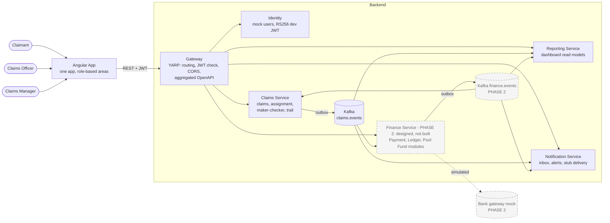

# ChubbBackEnd

Backend for the Chubb APAC claims platform: motor and property claims across six markets, with a claim progress trail and maker-checker on claim decisions. .NET 8 services sit behind a YARP gateway, each service owns its PostgreSQL database, and Kafka carries events (Kafka is not running yet).

Frontend: `../ChubbFrontEnd` (Angular). Full design: [docs/architecture/ARCHITECTURE.md](docs/architecture/ARCHITECTURE.md).

## Phase 1 vs Phase 2

| | Phase 1 (built, in docker compose) | Phase 2 (designed, not built) |
|---|---|---|
| Services | Gateway, Identity, Claims, Reporting, Notification | Finance: Payment, General Ledger, Pool Fund |
| Claims scope | Full trail; maker-checker on the decision; demo ends at Approved or Rejected | Settlement maker-checker, Settling, Settled, payee details, payments |
| Events | `claims.events` + DLQ | `finance.events` + DLQ |

- **Built (slice 1):** solution skeleton, Identity (login and seeded users), Gateway (routing, JWT check, CORS, merged OpenAPI). Claims, Reporting and Notification exist only as minimal hosts (health and JWT setup, no domain logic).
- **Not built yet:** Claims domain (claims, state machine, trail, maker-checker, outbox), Reporting and Notification logic, Kafka and its topics, the compose entries for Claims, Reporting, Notification and Kafka, Kafka UI, the Claims and other service contracts.
- **Phase 2:** designed in ADR-001, ADR-006 and ADR-007, with no code, compose entry or Gateway route.

## Architecture

Copied from [ARCHITECTURE.md, section 1](docs/architecture/ARCHITECTURE.md). Solid boxes are Phase 1; dashed boxes are Phase 2 (not built). Today, compose runs only the Gateway, Identity, Postgres and the `jwt-keys` init container.



## Prerequisites

- Docker with the `docker compose` plugin (verified with Docker 29.8.1 and Compose v5.5.1)
- .NET SDK 8.0 for tests and for running without Docker (`global.json` pins 8.0.100 with `latestFeature` roll-forward; verified with 8.0.131)
- `openssl` for `scripts/dev-keys.sh` (verified with OpenSSL 3.0.13)
- Optional: `gitleaks` and `trivy` for the security gate (neither is installed on the dev machine)

## Run (one command)

```bash
docker compose up --build
```

- Gateway: **http://localhost:8080** (bound to 127.0.0.1 only).
- Zero manual steps. Dev-only defaults are in `docker-compose.yml`; an optional git-ignored `.env` overrides `.env.example`.
- Stop: `docker compose down` (keeps the database). `docker compose down -v` also deletes the database and dev keys.

Check that it is up:

```bash
curl -i http://localhost:8080/health/ready
```

Get a token (the password is dev-only, see [Seeded users](#seeded-users)):

```bash
curl -s -X POST http://localhost:8080/auth/token \
  -H 'Content-Type: application/json' \
  -d '{"email":"claimant@chubb.test","password":"Dev-Only-Passw0rd!"}'
```

The response carries `accessToken`, `tokenType` (`Bearer`) and `expiresIn` (seconds, 1800 by default).

### Without Docker

1. `scripts/dev-keys.sh` writes an RS256 key pair to `.dev-keys/` (git-ignored; existing keys are kept).
2. Start a local PostgreSQL 16 with an empty database named `identity_db`.
3. In two terminals, from this folder:

   ```bash
   ASPNETCORE_ENVIRONMENT=Development \
   ConnectionStrings__IdentityDb='Host=localhost;Port=5432;Database=identity_db;Username=postgres;Password=<your-local-password>' \
   Identity__SeedPassword='Dev-Only-Passw0rd!' \
   dotnet run --no-launch-profile --project src/Identity --urls http://localhost:5001
   ```

   ```bash
   ASPNETCORE_ENVIRONMENT=Development \
   dotnet run --no-launch-profile --project src/Gateway --urls http://localhost:5000
   ```

The key paths default to `../../.dev-keys/` relative to each project folder. Override them with `Jwt__PrivateKeyPath` (Identity only) and `Jwt__PublicKeyPath`. Identity migrates and seeds on startup in Development. The Gateway's default cluster addresses are localhost ports 5001 to 5004, so Claims, Reporting and Notification return 502 unless they run too.

Verified on 2026-10-28 with a throwaway PostgreSQL 16 container: both hosts reported ready, and the local Gateway issued a token for a seeded user.

## Seeded users

**Dev only.** All six users share one password, `Dev-Only-Passw0rd!` (set by `Identity__SeedPassword` in `.env.example`). It is not used outside local development. Emails are matched case-insensitively.

| Email | Name | Market | Role(s) |
|---|---|---|---|
| `claimant@chubb.test` | Alex Claimant | SG | Claimant |
| `claimant2@chubb.test` | Bao Claimant | HK | Claimant |
| `officer@chubb.test` | Olivia Officer | SG | Officer |
| `officer2@chubb.test` | Omar Officer | SG | Officer |
| `manager@chubb.test` | Marcus Manager | SG | Manager |
| `officer.manager@chubb.test` | Dana Dual | SG | Officer and Manager (dual-role; maker-checker demo) |

Sources: emails, names, markets and roles in `src/Identity/Infrastructure/Persistence/IdentitySeeder.cs`; fixed user ids in `src/Contracts/DevSeed.cs`; the password in `.env.example`.

## URLs

| What | URL | Notes |
|---|---|---|
| Gateway | http://localhost:8080 | The only published port |
| Health | http://localhost:8080/health/live and `/health/ready` | Anonymous |
| Swagger UI | http://localhost:8080/swagger/ | Development only |
| Merged OpenAPI | http://localhost:8080/openapi/v1.json | Development only; today it lists `POST /auth/token` only |
| Kafka UI | not built | Arrives with the messaging slice |

`ASPNETCORE_ENVIRONMENT` defaults to `Development` in compose. Development also enables auto-migration, seeding and Swagger. No production configuration exists yet.

## Frontend client generation

The Angular client is planned to be generated from `http://localhost:8080/openapi/v1.json` (Development only), so the Gateway must be running first. It is **not generated yet**: the merged document contains only `POST /auth/token`, because the Claims, Reporting and Notification contracts are not in `contracts/openapi/`. The generator step is in the frontend repo and is blocked (see `../ChubbFrontEnd/README.md`).

## Security and networks

- **Per-service secrets.** No shared `env_file`. Each service lists only the keys it needs. The Gateway gets no database or Identity secret.
- **Database roles.** `docker/postgres/init-databases.sh` creates one database and one login role per service (identity, claims, reporting, notification). Only Identity is in use. The script runs only when the data volume is empty.
- **Signing keys.** The one-shot `jwt-keys` container creates an RS256 pair if none exists. The private key is mounted only into Identity; the public key is mounted read-only into the Gateway and the other services. Nothing is committed.
- **Networks.** `edge` carries the Gateway and the services it proxies to. `data` is `internal: true` and carries Postgres; it has no route out and the Gateway is not attached.
- **Containers.** Read-only root file systems, all capabilities dropped, `no-new-privileges`.

## Security gate

```bash
scripts/security-check.sh
```

Runs gitleaks (working tree and git history), `dotnet list package --vulnerable --include-transitive`, `dotnet format --verify-no-changes`, and trivy on built images when trivy is installed. Exits 1 on any failed check or missing required tool.

**Status on the dev machine (2026-10-28): `RESULT: FAILED`.** gitleaks is **MISSING** (not installed). The dependency audit and format checks pass. trivy is not installed, so the optional image scan is skipped. Skipping gitleaks is a recorded human decision (see the AI journal); it is not a pass. Install gitleaks: https://github.com/gitleaks/gitleaks#installing

## Tests

```bash
dotnet test ChubbBackEnd.sln
```

Needs Docker running, because the Identity tests start PostgreSQL 16 with Testcontainers. Last run on 2026-10-28: 86 passed (Identity 36, Gateway 47, Hosts 3). One earlier run exited 1 after all Identity tests passed, reporting a Testcontainers cleanup cancellation; a re-run passed. Not investigated.

## Known limitations

- No rate limiting or account lockout on `POST /auth/token`.
- No TLS. Services speak HTTP inside compose, and the Gateway is plain HTTP on loopback.
- Secrets are plain environment variables (visible with `docker inspect`). Dev-only defaults are written in `docker-compose.yml`.
- The `edge` network is flat: the Gateway, Identity and future services can reach each other's HTTP ports. Per-service JWT validation is the only limit.
- Mock identity: local RS256 dev keys, 30-minute tokens, no revocation, no refresh, one shared audience (`chubb-claims-api`).
- The `jwt-keys` container runs as root (the `alpine/openssl` image sets no user). It only writes the two key volumes.
- .NET 8 support ends **2026-11-10**. An upgrade is not scheduled.
- Gateway routes to Claims, Reporting and Notification return 502 in compose, because those hosts are not in compose yet.
- `/payments`, `/funds`, `/ledger` and `/internal/**` return 404 (Phase 2 or not exposed). `/claims/{id}/payee-details` is **not** routed to Finance yet: it falls under the Claims route, so it reaches Claims (502 today). The Finance route must come before it in the Gateway config when Phase 2 is built.
- Compose's Postgres init runs only on an empty volume, so a changed password in `.env` does not reach an existing database.

## Documentation

- [Architecture](docs/architecture/ARCHITECTURE.md) and [module detail](docs/architecture/MODULES.md)
- [ADRs 001 to 008](docs/adr/)
- [Security requirements](docs/security/SECURITY-REQUIREMENTS.md)
- [Identity and Gateway spec](docs/specs/identity-gateway/SPEC.md)
- [Task list](docs/planning/TASKS.md)
- [AI working journal](docs/journal/AI-JOURNAL.md)
- [Frontend README](../ChubbFrontEnd/README.md)
