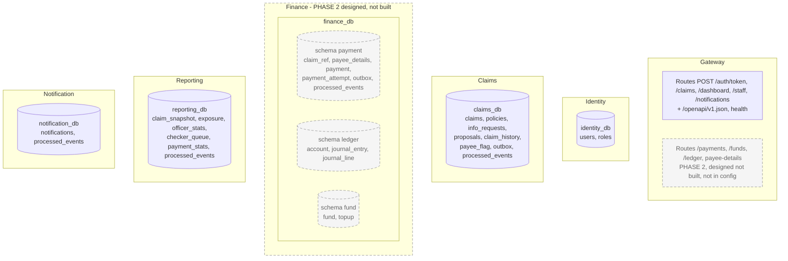
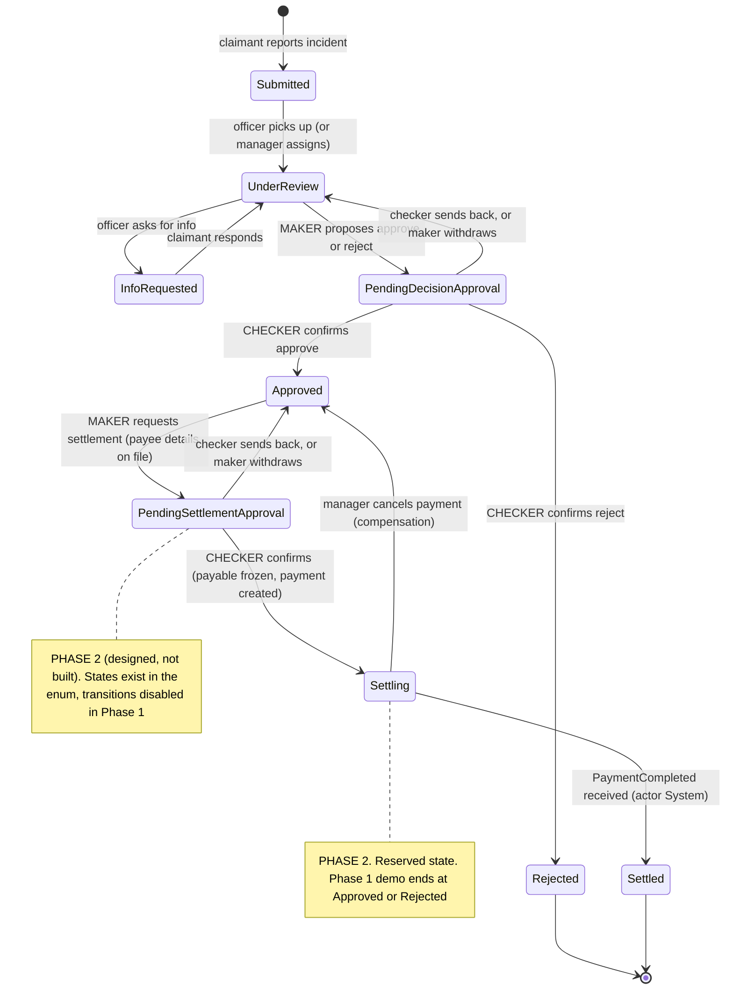
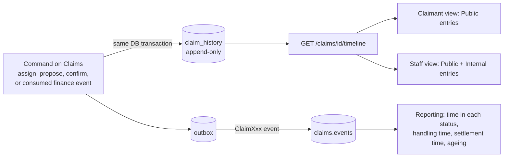
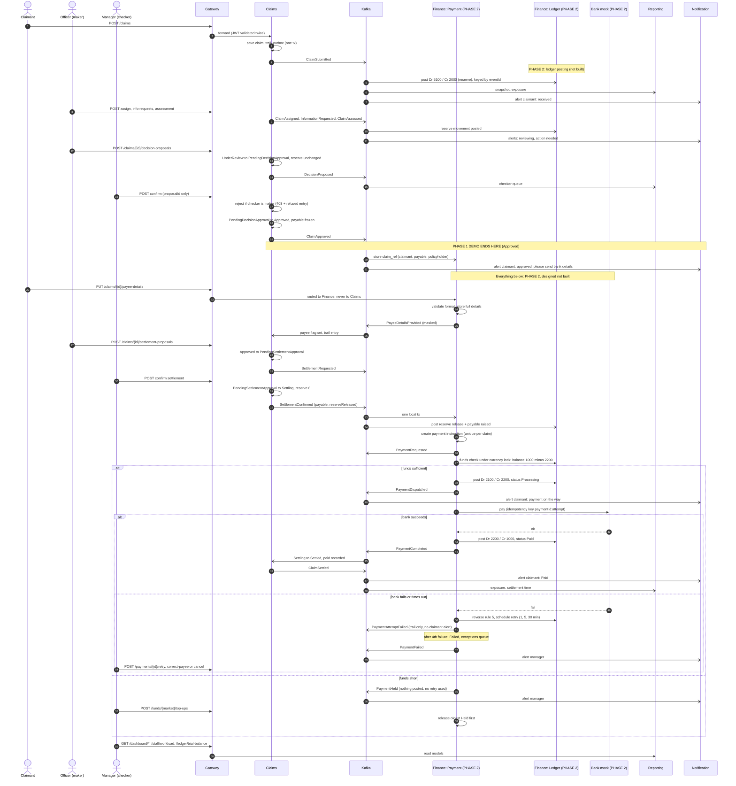
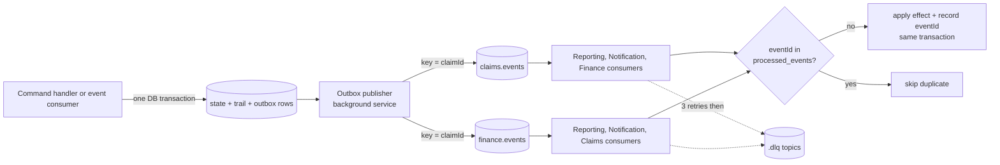
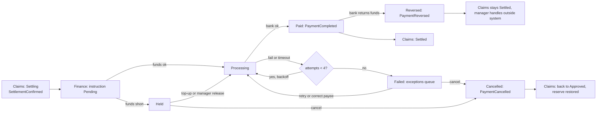
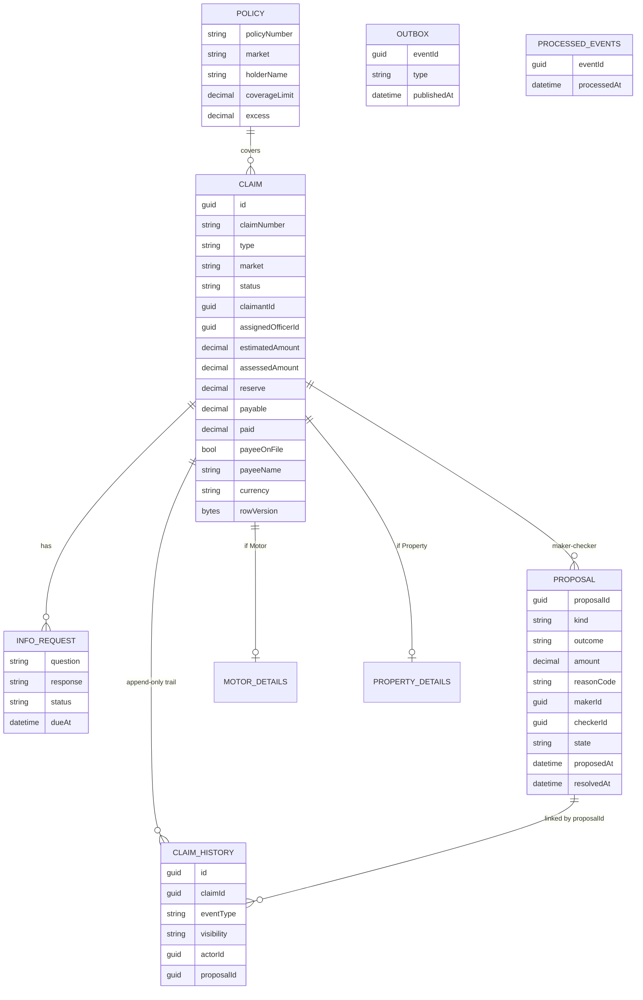
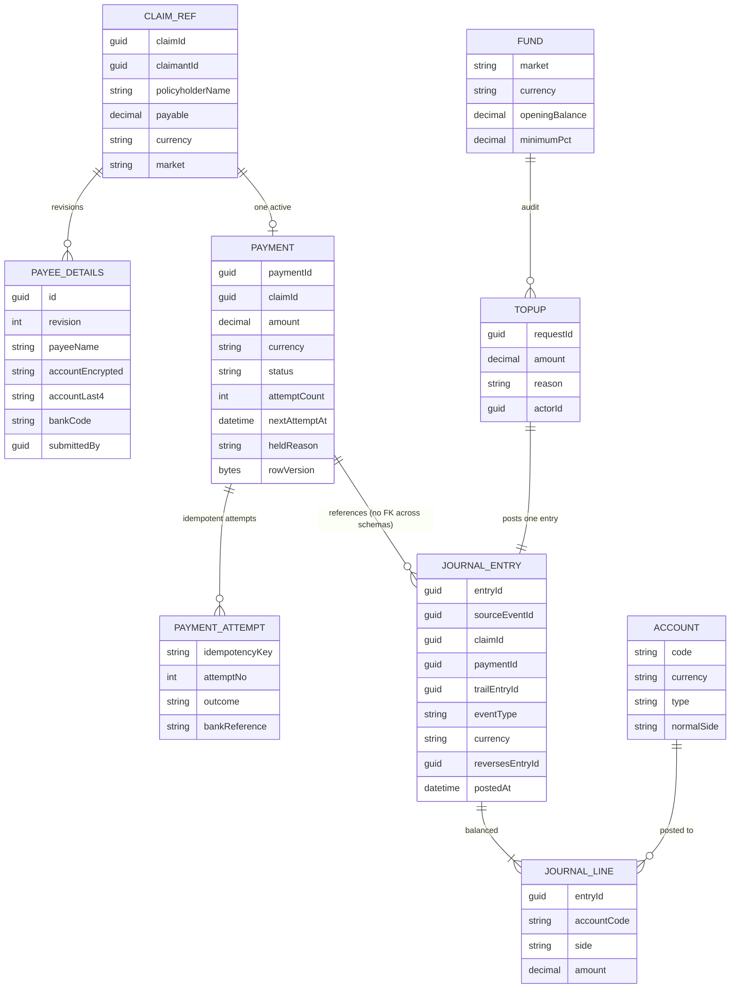
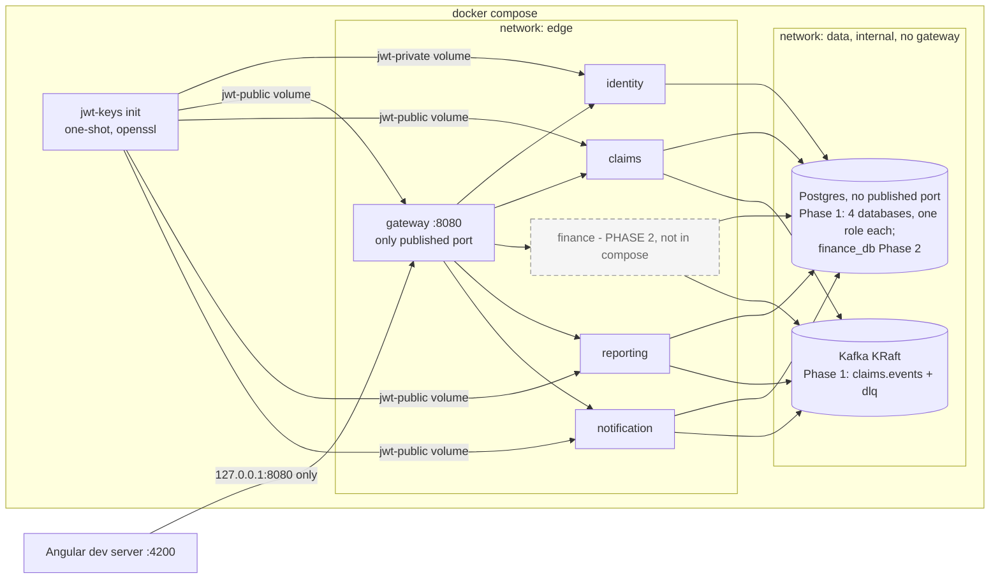

# Architecture – Chubb APAC Claims Platform (Backend)

Diagrams are Mermaid; they render in GitHub and the VS Code Markdown preview (Mermaid extension). This is the design we agreed to build; update it as decisions change. Domain rules: `docs/domain/business-rules.md` (BR-01 to BR-73). Decisions: `docs/adr/ADR-001` to `ADR-008`. Security: `docs/security/SECURITY-REQUIREMENTS.md`. Module detail and claimant alerts: `docs/architecture/MODULES.md`.

## 0. Phase boundary (human decision: 5-hour cap kept)

| | Phase 1 (built, in docker-compose) | Phase 2 (designed, NOT built) |
|---|---|---|
| Services | Gateway, Identity, Claims, Reporting, Notification | **Finance** (Payment, General Ledger, Pool Fund modules) |
| Claims scope | Full trail; maker-checker on the **decision**; demo ends at **Approved** (or Rejected) | Settlement maker-checker, `Settling`, `Settled`, payee details, payment events |
| Topics | `claims.events` + dlq | `finance.events` + dlq |

Legend used in every diagram and table: **dashed border / "Phase 2" label = designed, not built.** Solid = Phase 1. The Phase 2 design, ADRs (001, 006, 007), event contracts and security requirements stay in force so Phase 2 is an addition, not a rework.

**Extension points Phase 1 Claims must leave** (so Phase 2 needs no Claims rework): (1) the transactional outbox and event envelope are built and publish every Phase 1 event, including `ClaimAssessed` and `ClaimApproved` with `payable`, `currency`, `proposalId`; (2) the status enum and state machine already contain `PendingSettlementApproval`, `Settling`, `Settled`, with the transitions in section 3 present in the table but disabled by a feature flag `Settlement:Enabled=false` (returns 409 `phase-2-not-enabled`); (3) the `proposal` table is generic (`kind = Decision | Settlement`); (4) claim columns `payable`, `paid`, `payeeOnFile`, `payeeName` exist and are nullable; (5) consumer plumbing (`processed_events`, DLQ) exists in Reporting and Notification and is reusable by Claims for `finance.events`; (6) the Phase 2 Gateway routes (`/payments`, `/funds`, `/ledger`, and the exact payee-details route) are designed in section 2a and are **not** present in the Gateway `appsettings` (JSON has no comments and commented-out config is not allowed), so in Phase 1 they return 404 from the Gateway. Nothing in Phase 1 stores bank details.

Status legend used in section 11: **Build** (in the 5-hour plan), **Stretch** (built only if time remains), **Document** (designed, not built).

## 1. System context

Six services. Finance is one service with three modules (ADR-001).


Dashed = Phase 2 (not in docker-compose). In Phase 1 the Gateway has no Finance route and Claims consumes nothing from `finance.events`.

Claims and Finance never call each other on the money path; they exchange facts over Kafka. The only service-to-service REST is the daily reserve reconciliation (Finance asks Claims), on an internal route the Gateway does not expose.

## 2. Services and data ownership



Rule: each service owns its database. No cross-service queries or shared tables; data crosses only via REST or Kafka events. Inside Finance the three modules own their own schema and call each other only through in-process interfaces (enforced by an architecture test). The Pool Fund module stores no balance: balance is ledger account 1000.

| Service | Style | Responsibility | Source of truth for |
|---|---|---|---|
| Gateway | REST proxy | Single entry, token validation (authentication only; roles and ownership in each service), CORS, correlation id, request-header allowlist, aggregated OpenAPI from committed contract files (ADR-003) | nothing |
| Identity | REST | Seeded users per role (incl. one dual-role user), issues dev JWT | users, roles |
| Claims | REST in, Kafka in/out | Claims, state machine, maker-checker, trail, outbox | claim status, reserve, payable, paid, assignment, trail |
| Finance / Payment (Phase 2) | REST in, Kafka in/out | Payee details (full bank data), payment instruction, simulated bank, retries, funds check | payment status, bank details |
| Finance / Ledger (Phase 2) | internal + REST read | Append-only double-entry journal, trial balance | the financial record of money |
| Finance / Pool Fund (Phase 2) | REST | Fund view per market, top-ups, thresholds | top-up audit; balance = ledger 1000 |
| Reporting | Kafka in, REST out | Outstanding, exposure, workload, checker queue, payment stats | nothing (derived) |
| Notification | Kafka in, REST out | Claimant inbox and manager alerts, stub delivery | notifications |

## 2a. Gateway route table (YARP, `src/Gateway/appsettings.json`)

Gateway paths equal service paths (no rewriting). The Gateway enforces authentication only; roles and ownership are enforced by the owning service. Anything not listed returns 404 from the Gateway (anonymous fallback), including `/internal/**` and `/dev/**`.

| Route | Match | Cluster | Gateway policy | Status |
|---|---|---|---|---|
| `auth-token` | `POST /auth/token` (exact path and method) | identity | anonymous | Built |
| `claims` | `/claims/{**remainder}` | claims | authenticated | Built (host is minimal until the Claims slice) |
| `dashboard` | `/dashboard/{**remainder}` | reporting | authenticated | Built (minimal host until the Reporting slice) |
| `staff` | `/staff/{**remainder}` | reporting | authenticated | Built (minimal host until the Reporting slice) |
| `notifications` | `/notifications/{**remainder}` | notification | authenticated | Built (minimal host until the Notification slice) |
| `payee-details` | `/claims/{id}/payee-details` (GET, PUT), explicit `Order` lower than `claims` so it wins over the prefix route | finance | authenticated | **Phase 2: designed, not built, not in config** |
| `payments` | `/payments/{**remainder}` | finance | authenticated | **Phase 2: designed, not built, not in config** |
| `funds` | `/funds/{**remainder}` | finance | authenticated | **Phase 2: designed, not built, not in config** |
| `ledger` | `/ledger/{**remainder}` | finance | authenticated | **Phase 2: designed, not built, not in config** |

The Phase 2 rows are added to `appsettings.json` (plus a `finance` cluster, a compose entry and `contracts/openapi/finance.yaml`) only when Finance is built; they are deliberately not kept as commented-out config. The payee-details route must be more specific than and ordered before `/claims/{**remainder}`, otherwise bank details would be sent to Claims (BR-42); a Gateway test must assert it routes to Finance. Finance's internal reconciliation call to Claims (`/internal/**`) is never routed by the Gateway.

Request headers: the Gateway forwards only an allowlist (`Authorization`, `Accept*`, cache and conditional headers incl. `If-Match`, `Range`, `User-Agent`, W3C trace headers, `Idempotency-Key`) and sets `X-Correlation-Id` itself; every other inbound header (`X-User-*`, `X-Forwarded-User`, `Remote-User`, cookies) is dropped, and client-sent `X-Forwarded-*` values are not passed through (any `X-Forwarded-*` a service sees is set by YARP; services must not use it for identity or authorisation). `Content-Type`/`Content-Length` are content headers and travel with the body. A new header a service needs must be added to the allowlist and, if the browser sends it, to the CORS allowed headers.

## 3. Claim state machine (enforced in the Claims domain layer, ADR-005)



**Phase 1 build:** Submitted, UnderReview, InfoRequested, PendingDecisionApproval, Approved, Rejected, with maker-checker on the decision. **Phase 2 (dashed in the diagram notes):** PendingSettlementApproval, Settling, Settled and the two compensation edges.

- Maker = assigned officer; checker = Manager who is not the maker (compared on user id). The checker confirms exactly what was proposed or sends back with a reason; there is no edit.
- `Settling` = payment dispatched or being retried. A payment failure after 3 retries leaves the claim in Settling; a Held payment (insufficient funds) also leaves it in Settling. Only `PaymentCompleted` produces `Settled`.
- Invalid transitions return 409/422 problem details; every refused attempt by an authenticated user adds an Internal trail entry and changes nothing.
- Reserve and exposure change only on the second signature (BR-22). Exposure counts reserve on claims that are not Rejected or Settled; Settling claims are open at reserve 0 and the money owed is shown beside it as "in settlement".

## 3a. Claim progress trail (core feature)

Every change to a claim leaves an immutable entry. The trail is what the claimant, officer and manager read to see how a claim progressed, and what a regulator or dispute would rely on.



Entry fields: `id, claimId, occurredAt, fromStatus, toStatus, eventType, actorId, actorRole, summary, reason, visibility (Public | Internal), correlationId`, plus `proposalId, makerId, checkerId` on proposal entries.
- **Append-only:** no UPDATE or DELETE (DB role has INSERT/SELECT only); a correction is a new entry that references the earlier one.
- **Written atomically** with the state change and the outbox row. Entries caused by Finance events (payment dispatched, attempt failed, retries exhausted, cancelled, reversed) are written in the transaction that consumes the event and records its `eventId`.
- **Visibility:** claimants see Public entries only: milestones, questions to them, "Decision under review" while pending (no outcome, amount, names), the confirmed result, "Payment on the way", "Paid". Everything else is Internal: proposal content, send-backs, withdrawals, payment failures and retries, manager payment actions, refused attempts. Bank details never appear in any entry (masked last 4 at most, Internal only).
- **Refused attempts:** written in their own small transaction (the main one rolls back).
- **Frontend:** one timeline component, used on claimant, officer and manager views.

## 4. Process flow – end to end (decision, settlement, payment, ledger, alerts)

Phase 1 covers messages up to `ClaimApproved` and the Reporting/Notification reactions. Finance participants and everything after the Approved note are Phase 2.



## 5. Reliability – outbox, idempotent consumers, DLQ (ADR-004)



- A state change is never saved without its event, and never published without being saved.
- Delivery is at least once; consumers dedupe on `eventId`. Finance adds unique `journal_entry.source_event_id` and unique payment idempotency key as second guards.
- Kafka key = `claimId`, so one claim's events stay in order. Fund events key = `market-currency`.

## 6. REST vs Kafka – who uses which (ADR-002)

| Interaction | Protocol | Why |
|---|---|---|
| Frontend to any service | REST via Gateway | Request/response, user waits for the result |
| Submit, assign, propose, confirm, send back, withdraw | REST command to Claims | Immediate validation and a clear error (e.g. maker-cannot-check) |
| Payee details, payment retry/correct/cancel, top-up | REST command to Finance | Finance owns the data and validates synchronously |
| Dashboard, checker queue, payment stats | REST on Reporting | Precomputed read models |
| Payment queues, fund view, ledger, trial balance | REST on Finance | Finance owns this data; no replica needed |
| Claims to Finance and Finance to Claims | Kafka events | No synchronous dependency on the money path |
| Reserve reconciliation (daily) | Internal REST Finance to Claims | Needs a point-in-time comparison; Gateway does not expose it |

## 7. Event contracts (ADR-003)

Envelope (versioned, in the `Contracts` project; additive changes only):

```json
{
  "eventId": "guid",
  "type": "ClaimApproved",
  "version": 1,
  "occurredAt": "2026-10-27T10:00:00Z",
  "claimId": "guid",
  "market": "SG",
  "correlationId": "guid",
  "causationId": "guid",
  "payload": { "payable": 7500.00, "currency": "SGD", "proposalId": "guid", "makerId": "guid", "checkerId": "guid" }
}
```

Payloads never contain full bank details; payee data is `payeeName`, `accountLast4`, `revision` only.

### Events, producers and consumers

Phase column: P1 = published/consumed in Phase 1; **P2** = designed, not built. In Phase 1 `ClaimApproved` is still published (consumers: Reporting, Notification; the Finance consumer is Phase 2, and the "send bank details" alert is Phase 2 text). `ProposalWithdrawn` in Phase 1 covers decisions only.

C = Claims, PAY = Finance/Payment, LED = Finance/Ledger, RP = Reporting, NT = Notification. "trail" = consumer writes an Internal claim_history entry.

| Event | Topic (producer) | Consumers and effect | Phase |
|---|---|---|---|
| ClaimSubmitted | claims (C) | LED rule 1 post; RP counts, exposure; NT alert claimant (received) | P1 |
| ClaimAssigned / ClaimReassigned | claims (C) | RP workload; NT first assignment only | P1 |
| InformationRequested / InformationProvided / InformationReminderDue | claims (C) | RP; NT alerts | P1 |
| ClaimAssessed (reserve before/after, assessed, excess, payable) | claims (C) | LED rule 2 post; RP exposure | P1 |
| DecisionProposed | claims (C) | RP checker queue; NT optional "under review" | P1 |
| DecisionSentBack | claims (C) | RP checker queue; NT none (claimant never told) | P1 |
| ProposalWithdrawn (decision or settlement, incl. auto-withdraw on reassign) | claims (C) | RP checker queue | P1 |
| ClaimApproved (payable frozen) | claims (C) | PAY stores `claim_ref`; RP exposure; NT alert: approved, send bank details | P1 |
| ClaimRejected (reserve released) | claims (C) | LED rule 3 post; RP exposure released; NT alert | P1 |
| SettlementRequested | claims (C) | RP checker queue; NT optional | **P2** |
| SettlementSentBack | claims (C) | RP checker queue | **P2** |
| **SettlementConfirmed** (payable, reserve released) | claims (C) | PAY creates instruction and LED rule 4 post, one local tx; RP in-settlement; NT optional | **P2** |
| ClaimSettled (paid) | claims (C) | RP exposure to paid, settlement time; NT alert "Paid" | **P2** |
| SettlementCancelled (reserve restored) | claims (C) | RP exposure up; NT none | **P2** |
| PayeeDetailsProvided (masked, revision) | finance (PAY) | C sets `payee_on_file`, trail | **P2** |
| **PaymentRequested** | finance (PAY) | C trail; RP payment pipeline | **P2** |
| **PaymentHeld** (insufficient funds) | finance (PAY) | C trail Internal; RP; NT manager alert | **P2** |
| PaymentDispatched (first attempt only for claimant) | finance (PAY) | C trail; NT claimant "on the way" once per payment | **P2** |
| PaymentAttemptFailed | finance (PAY) | C trail Internal; RP first-attempt success metric; NT none | **P2** |
| **PaymentFailed** (retries exhausted) | finance (PAY) | C trail; RP exceptions queue; NT manager alert | **P2** |
| **PaymentCompleted** | finance (PAY) | C: Settling to Settled, paid = payable; RP | **P2** |
| PaymentCancelled | finance (PAY) | C: Settling to Approved, reserve restored, emits SettlementCancelled; RP | **P2** |
| **PaymentReversed** (bank return) | finance (PAY) | C trail only, claim stays Settled; RP; NT manager alert | **P2** |
| **FundToppedUp** | finance (Fund) | RP optional; in Finance, triggers release of Held payments (in process) | **P2** |
| FundBelowMinimum / LedgerOutOfBalance / ReconciliationBreak | finance | NT manager alert | P1 |
| RefusedAttempt | not published | trail only | P1 |

Ledger postings for payment steps (BR-55 rules 5 to 9) are made by Payment through `IPostingService` in the same transaction as the payment change; the Kafka event is for others, not for the ledger.

## 8. Cross-service consistency

Phase 1 consistency = Claims to Reporting and Notification (outbox, idempotent consumers, DLQ). Everything involving Finance below (reserve vs ledger, settlement saga, compensation) is **Phase 2: designed, not built**.

### Who owns what

| Fact | Source of truth | Copies and how they stay in step |
|---|---|---|
| Claim status, assigned officer, proposals, trail | Claims | Reporting snapshot via events; Finance `claim_ref` via ClaimApproved |
| Reserve per claim (operational) | **Claims** | Reporting exposure via events; ledger 2000 via events; daily reconciliation compares Claims vs ledger |
| Payable (frozen) | Claims, fixed at ClaimApproved | Finance copies it; SettlementConfirmed amount must equal it, else DLQ and no payment |
| Payment status, bank details | Finance/Payment | Claims holds only `payee_on_file` and trail; Reporting holds stats |
| Money balances, fund balance | **Ledger** (account 1000 = pool fund) | Reporting reads no balances; managers read Finance directly |
| Paid | Claims records at PaymentCompleted | Equals sum of ledger 1000 outflows for the claim; checked in reconciliation |

Reserve rule: Claims is authoritative for what the reserve is (it enforces BR-22); the ledger is authoritative for the financial record derived from it. Neither overwrites the other. A difference is a reported break, fixed by a reversing entry or by replaying the event, never by editing.

### The settlement saga (choreography, ADR-006)



### Failure and compensation

| Situation | What happens | Claims | Ledger |
|---|---|---|---|
| Bank fails or times out (attempts 1 to 3) | auto retry, same key on timeout | Settling, trail Internal | rule 7 reverses rule 5 each failure |
| All 4 attempts fail | Failed, exceptions queue, manager alert | Settling | clearing back to payable |
| Manager retry | new cycle, new attempt number | Settling | rule 5 again |
| Manager corrects payee | new revision, then retry | Settling | none |
| Funds short | Held, no retry consumed | Settling, claimant not told | nothing posted |
| Manager cancels (Pending/Held/Failed) | PaymentCancelled | Settling to Approved, reserve restored, officer may re-request | rule 9 |
| Cancel while Processing or Paid | refused 409 | unchanged | unchanged |
| Bank returns Paid payment | PaymentReversed | stays Settled | rule 8 |
| Duplicate PaymentCompleted | skipped by inbox | no second Settled | none |
| Claims down when PaymentCompleted arrives | event waits in Kafka | Settling until Claims returns | already posted |
| Finance down after SettlementConfirmed | event waits in Kafka | Settling | not yet posted |
| Event unusable (amount mismatch, claim not Settling) | DLQ, ReconciliationBreak alert | unchanged | unchanged |

### Honest limits
- Between SettlementConfirmed and PaymentCompleted the system is eventually consistent; `Settling` is the explicit, visible state for that window and Reporting shows count and age.
- No distributed transaction; exactly-once effect comes from idempotency keys plus unique constraints.
- BR-44 says the payment instruction is created in the same transaction as the settlement confirm. Across two services this is not possible; the equivalent guarantee is: confirm and `SettlementConfirmed` outbox row are atomic, and the instruction is created exactly once on consumption (unique per claim). BA to accept this reading.
- Payee details live only in Finance (BR-42), so Claims cannot validate account details itself; it checks the `payee_on_file` flag and policyholder name from `PayeeDetailsProvided`. If the flag lags a second, the settlement request returns a retryable 422.

## 9. Main entities

### Claims service (Phase 1; `payable`, `paid`, `payeeOnFile`, `payeeName` and `PROPOSAL.kind = Settlement` are reserved for Phase 2 and nullable)



Proposal constraints: partial unique index (one open proposal per claim), `CHECK (checkerId IS NULL OR checkerId <> makerId)`. Claims keeps no bank details.

### Finance service (one database, three schemas) – PHASE 2: designed, not built



Ledger tables: application role has INSERT/SELECT only plus an update/delete-blocking trigger; `source_event_id` unique; check `amount > 0`; entry totals checked in the posting service and by a deferred constraint trigger. `payee_details.accountEncrypted` is encrypted at rest (ASP.NET Data Protection; KMS is a production gap).

## 10. Local runtime (docker-compose)



Built today (slice 1): `jwt-keys`, `postgres` (data), `identity` (edge + data), `gateway` (edge only). Claims, Reporting and Notification join both networks in their slices; Kafka is added by the messaging slice and is planned on the `data` network (the Gateway never reaches the broker or the database). Each service's compose entry lists only the environment keys and secrets it needs (no shared `env_file`): Identity gets only its own DB connection string, the seed password and the private-key path; the Gateway gets no database or Identity secret at all. Each service has its own Postgres role and password, created by the init script; only the `postgres` container holds the admin and all role passwords. App containers run read-only, with all capabilities dropped and `no-new-privileges`.

`docker compose up` starts everything with zero manual steps; the `jwt-keys` init container generates the dev RS256 pair once (nothing committed; private key only in Identity, ADR-008 amendment); migrations and seed (users, policies incl. excess and holder name) run on startup. Phase 2 adds the chart of accounts and six funds with opening ledger entries.

## 11. Build order and cut line (5-hour hard cap; Phase 1 vs Phase 2)

**Phase boundary (human decision):** Phase 1 = Gateway, Identity, Claims (trail, maker-checker on the decision), Reporting, Notification. Phase 2 = Finance (Payment, General Ledger, Pool Fund), settlement maker-checker, Settling/Settled. Finance is not in the Phase 1 docker-compose; the Phase 1 demo ends at **Approved** (or Rejected).

| Phase | Content | Cum. time | Status |
|---|---|---|---|
| 0 | Solution skeleton, compose (Postgres, Kafka), `Contracts`, OpenAPI for Claims, Identity (RS256 JWT, dual-role seed user), Gateway, aggregated OpenAPI | 1:00-1:15 (re-estimated, was 0:30; see note) | Build |
| 1a | **Claims**: intake, assign, info requests, assessment, state machine with all 9 states in the enum, `claim_history` trail, outbox publishing every Phase 1 event, generic proposals, **decision** propose/confirm/send-back/withdraw/auto-withdraw, maker-checker in domain, rowVersion, refused-attempt entries, unit + security tests S1-S16 (decision part) | 2:00 | Build |
| 1b | Reporting (outstanding, exposure, workload, checker queue) and Notification (idempotent consumer, claimant inbox, alert rules) | 2:45 | Build |
| | **CUT LINE (about 2:45 to 3:00)**: `docker compose up` shows Claims + trail + decision maker-checker + dashboards + alerts working end to end to Approved, tests green, security check run | 3:00 | Must |
| 1c | Remaining time to 5:00: hardening, Testcontainers tests for outbox/DLQ/idempotency, frontend contract support, README, ADR/diagram sync, AI journal, `security-check.sh`; then optional SHOULD items (reminders, templates, stub delivery) | 5:00 | Must / Should |
| 2 | **Finance** (Phase 2, designed not built), in this order when it starts: F1 payment + simulated bank + idempotency + 3 retries + ledger rules + settlement maker-checker + Settled; F2 funds check/Held/top-up/manager actions; F3 cancel, reversal, reconciliation, thresholds | next sprint | Documented |

**Re-estimate note (2026-10-28, identity-gateway spec review):** row 0 is realistically 60-75 minutes (skeleton, Identity, Gateway, aggregation, about 30 tests), not 30. Rows 1a and 1b are not re-planned here: unchanged, they move 30-45 minutes later and push the cut line towards 3:15-3:30. Whether to absorb that from 1c or cut scope is a `product-owner` decision. The technical cut order for slice 1 is in the spec (Swagger UI, then extra aggregation tests, then tests for the two extra seed users); RS256 is not cut (ADR-008).

No Phase 1 work is scheduled for Finance, and no StubPayment is built (the demo stops at Approved).

**Phase 2 needs no Claims rework** because of the extension points in section 0: events and outbox already published, Settling and Settlement states reserved behind a flag, generic proposals, nullable money columns. Phase 2 adds: Finance service, `finance.events` topic and Claims consumer, settlement endpoints enabled, Gateway routes, compose entries, ERD tables.

**Documented, not built (all of Phase 2 plus):** settlement maker-checker, payee details, payments, retries, ledger, pool fund, reconciliation, reminders (COULD), real email/SMS, OIDC, KMS, Kafka ACLs, schema registry, period close, manual journals.

**Honest risk:** even Phase 1 is five services, a nine-state machine, a trail, maker-checker, an outbox and two consumers in 5 hours; Phase 2 would roughly double it. Deferring Finance is the right call; the risk now is that the reviewer sees a design larger than the build, so every Phase 2 element is labelled and the build is solid within its scope.

## 12. Known trade-offs (for the walkthrough)

- Five services are built in Phase 1 (six in the full design) for a small domain is more than strictly needed; we chose it to show boundaries, async messaging and database-per-service. Gateway, Identity, Notification are deliberately thin. Finance is one service with three modules, not three services (ADR-001).
- Reporting and the ledger are eventually consistent with Claims; "Settling" makes the payment window explicit. "Real time" means polling or SSE on top.
- Choreographed saga across two services; no coordinator, no 2PC.
- Exposure uses a static FX table in Reporting; the ledger never sums across currencies.
- Mock JWT (RS256, dev keys) only; production would use OIDC. Payment gateway is a simulator; bank details are encrypted at rest with a dev key.
- Top-ups have no maker-checker (manager-only, reasoned, audited); flagged as a control gap in SECURITY-REQUIREMENTS.
