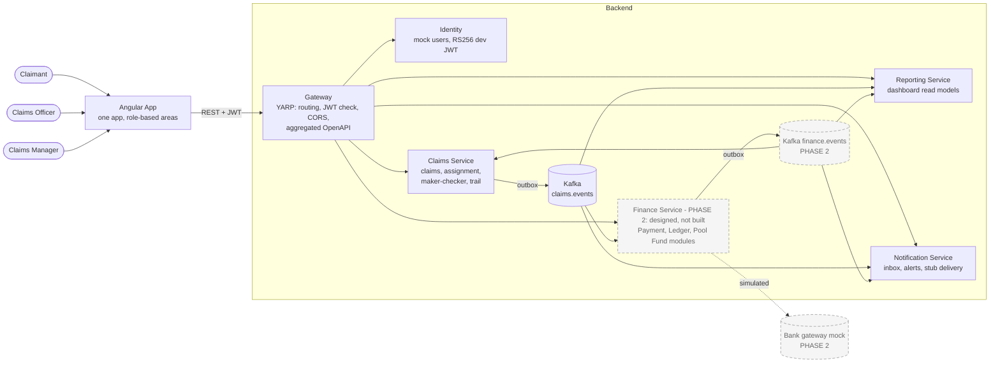
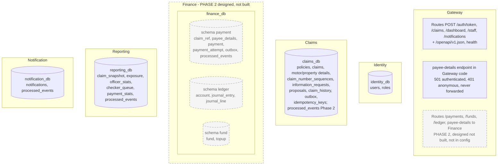
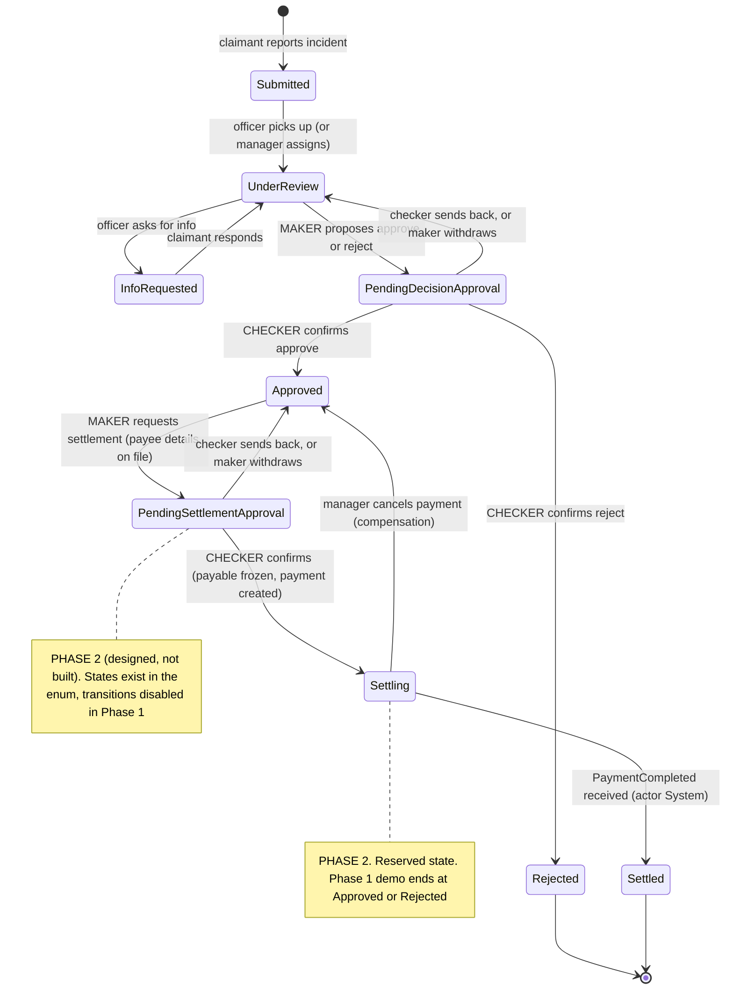
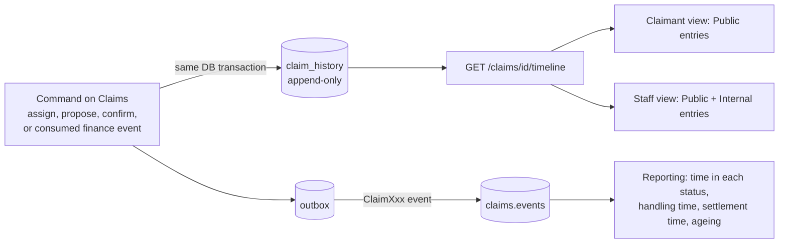
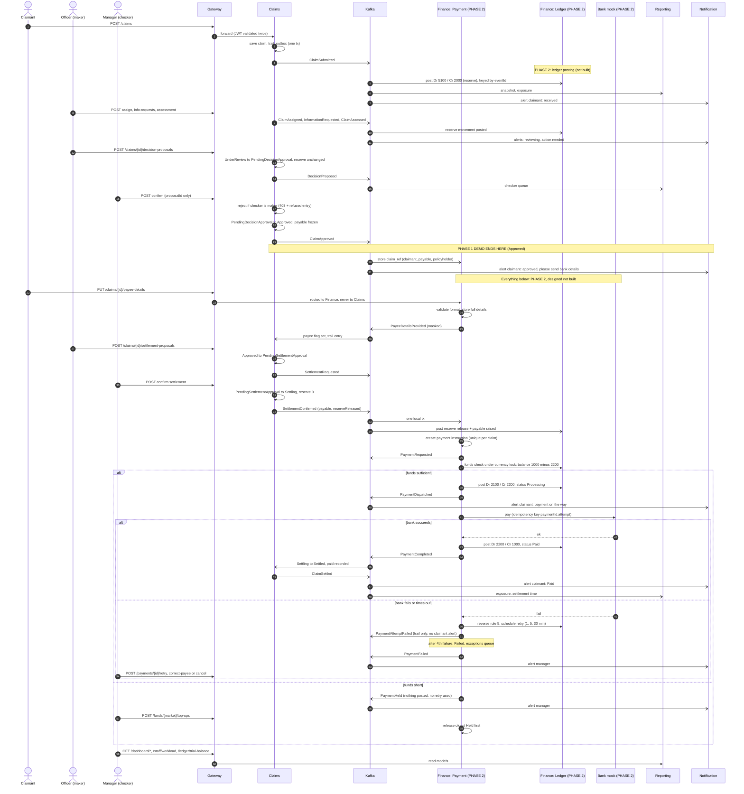
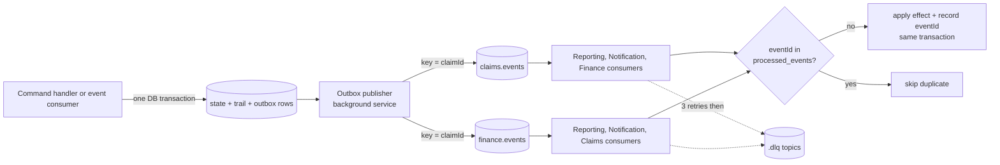
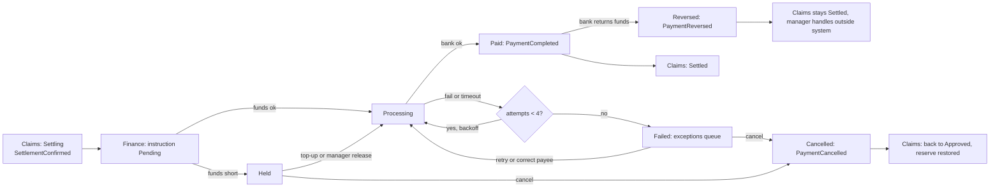
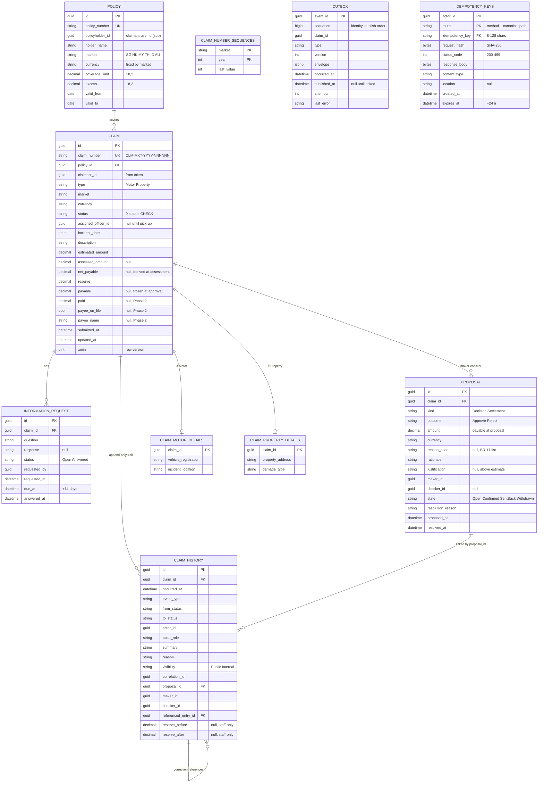
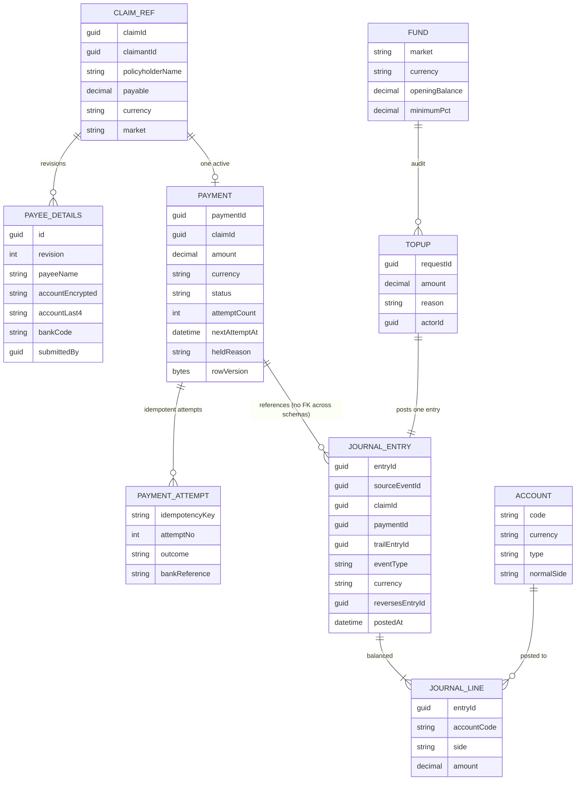
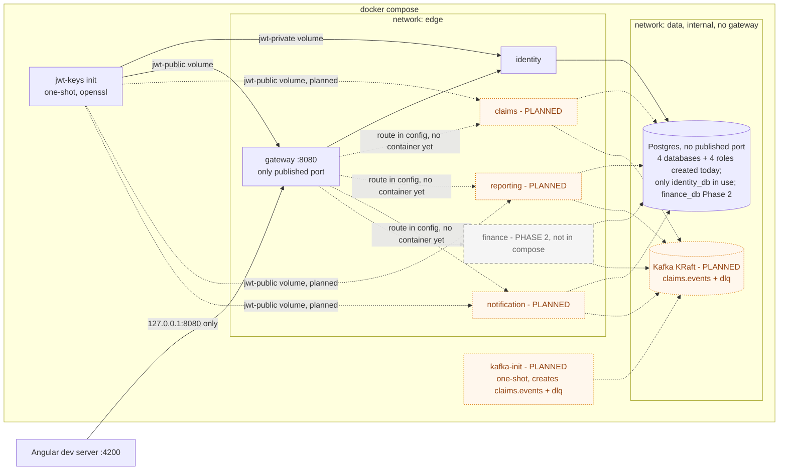

# Architecture – Chubb APAC Claims Platform (Backend)

Diagrams are Mermaid; they render in GitHub and the VS Code Markdown preview (Mermaid extension). This is the design we agreed to build; update it as decisions change. Domain rules: `docs/domain/business-rules.md` (BR-01 to BR-87). Decisions: `docs/adr/ADR-001` to `ADR-010`. Security: `docs/security/SECURITY-REQUIREMENTS.md`. Module detail and claimant alerts: `docs/architecture/MODULES.md`.

## 0. Phase boundary (human decision: 5-hour cap kept)

| | Phase 1 (this build; what compose runs today is in section 10) | Phase 2 (designed, NOT built) |
|---|---|---|
| Services | Gateway, Identity, Claims, Reporting, Notification | **Finance** (Payment, General Ledger, Pool Fund modules) |
| Claims scope | Full trail; maker-checker on the **decision**; demo ends at **Approved** (or Rejected) | Settlement maker-checker, `Settling`, `Settled`, payee details, payment events |
| Topics | `claims.events` + dlq | `finance.events` + dlq |

Legend used in every diagram and table: **dashed border / "Phase 2" label = designed, not built.** Solid = Phase 1. The Phase 2 design, ADRs (001, 006, 007), event contracts and security requirements stay in force so Phase 2 is an addition, not a rework.

**Extension points Phase 1 Claims must leave** (so Phase 2 needs no Claims rework): (1) the transactional outbox and event envelope are built and publish every Phase 1 event, including `ClaimAssessed` and `ClaimApproved` with `payable`, `currency`, `proposalId`; (2) the status enum and state machine already contain `PendingSettlementApproval`, `Settling`, `Settled`, with the transitions in section 3 present in the table but disabled by a feature flag `Settlement:Enabled=false` (returns 409 `phase-2-not-enabled`); (3) the `proposal` table is generic (`kind = Decision | Settlement`); (4) claim columns `payable`, `paid`, `payeeOnFile`, `payeeName` exist and are nullable; (5) consumer plumbing (`processed_events`, DLQ) exists in Reporting and Notification and is reusable by Claims for `finance.events`; (6) the Phase 2 Gateway routes (`/payments`, `/funds`, `/ledger`, and the exact payee-details route) are designed in section 2a. `/payments`, `/funds` and `/ledger` are **not** in the Gateway `appsettings` (JSON has no comments and commented-out config is not allowed), so in Phase 1 they return 404 from the Gateway. The payee-details path `/claims/{claimId}/payee-details` is different: it would otherwise match the `/claims/{**remainder}` route and reach Claims, so the Gateway maps it in code as a minimal API endpoint (`src/Gateway/Api/PayeeDetailsRoute.cs`, mapped before `MapReverseProxy`). It returns **501** to authenticated callers and **401** to anonymous callers for every method, and never forwards. Nothing in Phase 1 stores bank details.

Status legend used in section 11: **Build** (in the 5-hour plan), **Stretch** (built only if time remains), **Document** (designed, not built).

## 1. System context

Six services. Finance is one service with three modules (ADR-001).



Dashed = Phase 2 (not in docker-compose). This is the Phase 1 target design; Claims, Reporting, Notification and Kafka are not yet in docker-compose (section 10 lists what runs today). In Phase 1 the Gateway has no Finance route and Claims consumes nothing from `finance.events`.

Claims and Finance never call each other on the money path; they exchange facts over Kafka. The only service-to-service REST is the daily reserve reconciliation (Finance asks Claims), on an internal route the Gateway does not expose.

## 2. Services and data ownership



Rule: each service owns its database. No cross-service queries or shared tables; data crosses only via REST or Kafka events. Inside Finance the three modules own their own schema and call each other only through in-process interfaces (enforced by an architecture test). The Pool Fund module stores no balance: balance is ledger account 1000.

| Service | Style | Responsibility | Source of truth for |
|---|---|---|---|
| Gateway | REST proxy | Single entry, token validation (authentication only; roles and ownership in each service), CORS, correlation id, request-header allowlist, aggregated OpenAPI from committed contract files (ADR-003) | nothing |
| Identity | REST | Seeded users per role (incl. one dual-role user), issues dev JWT | users, roles |
| Claims | REST in, Kafka in/out | Claims, state machine, maker-checker, trail, outbox | claim status, reserve, payable, paid, assignment, trail |
| Finance / Payment (Phase 2) | REST in, Kafka in/out | Payee details (full bank data), payment instruction, simulated bank, retries, funds check | payment status, bank details |
| Finance / Ledger (Phase 2) | internal + REST read | Append-only double-entry journal, trial balance | the financial record of money |
| Finance / Pool Fund (Phase 2) | REST | Fund view per market, top-ups, thresholds | top-up audit; balance = ledger 1000 |
| Reporting | Kafka in, REST out | Outstanding, exposure, workload, checker queue, payment stats | nothing (derived) |
| Notification | Kafka in, REST out | Claimant inbox and manager alerts, stub delivery | notifications |

## 2a. Gateway route table (YARP, `src/Gateway/appsettings.json`)

Gateway paths equal service paths (no rewriting). The Gateway enforces authentication only; roles and ownership are enforced by the owning service. Anything not listed returns 404 from the Gateway (anonymous fallback), including `/internal/**` and `/dev/**`.

| Route | Match | Target | Gateway policy | Status |
|---|---|---|---|---|
| `auth-token` | `POST /auth/token` (exact path and method) | identity cluster | anonymous | Built |
| `claims` | `/claims/{**remainder}` | claims cluster | authenticated | Route in config; minimal host and Dockerfile exist, container **not yet in compose** (Claims slice) |
| `dashboard` | `/dashboard/{**remainder}` | reporting cluster | authenticated | Route in config; minimal host and Dockerfile exist, container **not yet in compose** (Reporting slice) |
| `staff` | `/staff/{**remainder}` | reporting cluster | authenticated | Route in config; minimal host and Dockerfile exist, container **not yet in compose** (Reporting slice) |
| `notifications` | `/notifications/{**remainder}` | notification cluster | authenticated | Route in config; minimal host and Dockerfile exist, container **not yet in compose** (Notification slice) |
| payee-details guard | `/claims/{claimId}/payee-details`, any method | **none**: a minimal API endpoint in Gateway code (`src/Gateway/Api/PayeeDetailsRoute.cs`), mapped before `MapReverseProxy` so its literal segment outranks the `claims` catch-all | authenticated | **Built (Phase 1).** 501 for an authenticated caller, 401 for an anonymous one, never forwarded to Claims. Tested by `Gateway_PayeeDetails_Authenticated_Returns501AndNeverReachesClaims` and `Gateway_PayeeDetails_WithoutToken_Returns401AndNeverReachesClaims` |
| `payee-details` | `/claims/{id}/payee-details` (GET, PUT), explicit `Order` lower than `claims` | finance cluster | authenticated | **Phase 2: designed, not built, not in config.** Replaces the guard above |
| `payments` | `/payments/{**remainder}` | finance cluster | authenticated | **Phase 2: designed, not built, not in config** (404 in Phase 1) |
| `funds` | `/funds/{**remainder}` | finance cluster | authenticated | **Phase 2: designed, not built, not in config** (404 in Phase 1) |
| `ledger` | `/ledger/{**remainder}` | finance cluster | authenticated | **Phase 2: designed, not built, not in config** (404 in Phase 1) |

Until the Claims, Reporting and Notification containers are added, an authenticated request to `claims`, `dashboard`, `staff` or `notifications` under `docker compose` gets an error from the Gateway, because YARP cannot reach the destination (expect 502). An anonymous request gets 401 first. This is expected and not a defect. The payee-details guard is not affected: it answers in the Gateway itself.

Why a code-mapped guard and not "absent from config, 404" for payee details: without it, `/claims/{id}/payee-details` matches `/claims/{**remainder}` and a claimant's bank details would be forwarded to Claims, which must never hold them (BR-42). Why 501 and not 404: the path is designed and will exist, so 501 `not-implemented` is the truthful answer, and it is distinct from the unmapped-path 404, so a test can tell the two apart.

When Finance is built: delete `PayeeDetailsRoute.cs` and its `MapPayeeDetailsNotImplemented()` call, add the Phase 2 rows to `appsettings.json` (plus a `finance` cluster, a compose entry and `contracts/openapi/finance.yaml`), and replace the two 501/401 tests with a test that asserts `/claims/{id}/payee-details` is routed to the **finance** destination and never to claims. The Phase 2 rows are deliberately not kept as commented-out config. Finance's internal reconciliation call to Claims (`/internal/**`) is never routed by the Gateway.

Idempotency headers (ADR-009): `Idempotency-Key` is on the request allowlist and in the CORS allowed headers. The CORS exposed headers are `X-Correlation-Id`, `ETag`, `Idempotent-Replayed`, `Retry-After` and `Location` (built, `src/Gateway/Api/CorsSetup.cs`, checked 2026-10-28), so the browser can read the replay flag, the in-progress retry hint and the created claim's location. Responses pass through YARP unchanged. The frontend still reads the new claim id from the 201 body (section 9), not from `Location`.

Request headers: the Gateway forwards only an allowlist (`Authorization`, `Accept*`, cache and conditional headers incl. `If-Match`, `Range`, `User-Agent`, W3C trace headers, `Idempotency-Key`) and sets `X-Correlation-Id` itself; every other inbound header (`X-User-*`, `X-Forwarded-User`, `Remote-User`, cookies) is dropped, and client-sent `X-Forwarded-*` values are not passed through (any `X-Forwarded-*` a service sees is set by YARP; services must not use it for identity or authorisation). `Content-Type`/`Content-Length` are content headers and travel with the body. A new header a service needs must be added to the allowlist and, if the browser sends it, to the CORS allowed headers.

## 3. Claim state machine (enforced in the Claims domain layer, ADR-005)



**Phase 1 build:** Submitted, UnderReview, InfoRequested, PendingDecisionApproval, Approved, Rejected, with maker-checker on the decision. **Phase 2 (dashed in the diagram notes):** PendingSettlementApproval, Settling, Settled and the two compensation edges.

- Maker = assigned officer; checker = Manager who is not the maker (compared on user id). The checker confirms exactly what was proposed or sends back with a reason; there is no edit.
- `Settling` = payment dispatched or being retried. A payment failure after 3 retries leaves the claim in Settling; a Held payment (insufficient funds) also leaves it in Settling. Only `PaymentCompleted` produces `Settled`.
- Invalid transitions return 409/422 problem details; every refused attempt by an authenticated user adds an Internal trail entry and changes nothing. Which 403s count as a refused attempt is **DECIDED (human, 2026-10-28)** in ADR-009: only resource-rule refusals after the role policy passed (non-assigned officer, maker equals checker, non-maker withdraw, lost race) are trailed and stored; role-policy 403s and claimant-ownership 404s are logged as security events only, not trailed and not stored.
- Reserve and exposure change only on the second signature (BR-22). Exposure counts reserve on claims that are not Rejected or Settled; Settling claims are open at reserve 0 and the money owed is shown beside it as "in settlement".

## 3a. Claim progress trail (core feature)

Every change to a claim leaves an immutable entry. The trail is what the claimant, officer and manager read to see how a claim progressed, and what a regulator or dispute would rely on.



Entry fields: `id, claimId, occurredAt, fromStatus, toStatus, eventType, actorId, actorRole, summary, reason, visibility (Public | Internal), correlationId`, plus `proposalId, makerId, checkerId` on proposal entries, `referencedEntryId` on Correction entries (BR-74), and `reserveBefore, reserveAfter` (claim currency, staff-only) on the primary entry of any command that changes the reserve (BR-22: submit, assess, confirm). These fields can sit on a Public primary entry (Submitted), so the claimant projection exposes only `id, occurredAt, summary` and never these fields.
- **Entry count per action (BR-04, decision log 15):** one primary entry, plus at most one Public companion where BR-08 defines a claimant milestone. In Phase 1 the only companions are "Decision under review" on the claim's **first** decision proposal and the final "Claim approved/rejected" on confirm. Send-back, withdrawal and later proposals are Internal only.
- **Append-only:** no UPDATE or DELETE. A `BEFORE UPDATE OR DELETE` row trigger and a `BEFORE TRUNCATE` statement trigger raise an exception, and the migration revokes UPDATE, DELETE and TRUNCATE on `claim_history` from the Claims role. A correction is a new entry that references the earlier one. Honest limit: in Phase 1 the Claims role also runs migrations and owns the table, so it could re-grant itself or drop the trigger. The guard stops application bugs, not a compromised Claims container. Production: a separate migration role owns the schema and the runtime role gets only INSERT and SELECT (SECURITY-REQUIREMENTS section 6).
- **Written atomically** with the state change, the outbox row and the idempotency record (ADR-009). Entries caused by Finance events (payment dispatched, attempt failed, retries exhausted, cancelled, reversed) are written in the transaction that consumes the event and records its `eventId`.
- **Visibility:** claimants see Public entries only: milestones, questions to them, "Decision under review" while pending (no outcome, amount, names), the confirmed result, "Payment on the way", "Paid". Everything else is Internal: proposal content, send-backs, withdrawals, payment failures and retries, manager payment actions, refused attempts. Bank details never appear in any entry (masked last 4 at most, Internal only).
- **Refused attempts:** the command's changes are discarded with `ROLLBACK TO SAVEPOINT`, then the Refused entry is inserted in the same transaction and commits with the stored refusal response. A replay with the same key therefore returns the same refusal and never writes a second entry (ADR-009, BR-86; this replaces the earlier "own small transaction").
- **Idempotent commands:** every Claims command needs an `Idempotency-Key`. A replay returns the stored response with `Idempotent-Replayed: true` and writes nothing, so entry counts reflect real attempts, not network repeats (ADR-009, BR-79 to BR-87).
- **Frontend:** one timeline component, used on claimant, officer and manager views.

## 4. Process flow – end to end (decision, settlement, payment, ledger, alerts)

Phase 1 covers messages up to `ClaimApproved` and the Reporting/Notification reactions. Finance participants and everything after the Approved note are Phase 2.



## 5. Reliability – outbox, idempotent consumers, DLQ (ADR-004)



- A state change is never saved without its event, and never published without being saved.
- Delivery is at least once; consumers dedupe on `eventId`. Finance adds unique `journal_entry.source_event_id` and unique payment idempotency key as second guards.
- Kafka key = `claimId`, so one claim's events stay in order. Fund events key = `market-currency`.
- **Outbox order (ADR-010, ruled at the claims-persistence review):** `sequence` is assigned at INSERT, not at commit, so across claims commit order can differ from `sequence` order. That is harmless because order matters only per claim. Per claim it holds because every command that writes outbox rows also updates the claim row under `xmin`: a second writer either sees the first one's commit (and inserts later, so gets a higher `sequence`) or loses the race and rolls back. Publisher rules that follow: (1) never use a high-watermark ("sequence > last published"); always select unpublished rows `ORDER BY sequence`; (2) on a publish failure, stop the batch, so no later row of that claim is sent first; (3) one publisher instance per database in Phase 1 (with several instances, `SKIP LOCKED` could split one claim's rows); (4) producer `acks=all`, `enable.idempotence=true`.
- **Poison outbox row (producer side, ADR-004 amendment):** on a failed publish, `attempts + 1` and `last_error` set to exception type plus message, sanitised (no payload, no stack) and truncated to 1,000 characters (CHECK). Then back off with a capped exponential delay (1 s doubling to 60 s) and retry the same row. After 10 attempts, or at once on a non-retryable error (serialisation, message too large, unknown topic, authorisation), the publisher stops at that row: it keeps retrying at the 60 s cap and publishes nothing behind it. It logs `OutboxStuck` once per state change, and an `outbox` health check reports **Degraded** (not Unhealthy, because the command API still works). The row is **never** sent to a DLQ: the DLQ is for unusable inbound messages, and a producer-side DLQ would lose or reorder a committed fact. Topic names and Kafka header names are constants in `Contracts` (`Topics`, `KafkaHeaderNames`).
- **API-side duplicates** (client resends) are stopped before they reach the outbox: the `Idempotency-Key` record commits in the same transaction as state, trail and outbox, so a replay creates no second event (ADR-009). The three guards stay separate: `Idempotency-Key` (client to Claims), `processed_events` (Kafka to consumer), payment idempotency key (Finance to bank, Phase 2).

## 6. REST vs Kafka – who uses which (ADR-002)

| Interaction | Protocol | Why |
|---|---|---|
| Frontend to any service | REST via Gateway | Request/response, user waits for the result |
| Submit, assign, propose, confirm, send back, withdraw | REST command to Claims | Immediate validation and a clear error (e.g. maker-cannot-check) |
| Payee details, payment retry/correct/cancel, top-up | REST command to Finance | Finance owns the data and validates synchronously |
| Dashboard, checker queue, payment stats | REST on Reporting | Precomputed read models |
| Payment queues, fund view, ledger, trial balance | REST on Finance | Finance owns this data; no replica needed |
| Claims to Finance and Finance to Claims | Kafka events | No synchronous dependency on the money path |
| Reserve reconciliation (daily) | Internal REST Finance to Claims | Needs a point-in-time comparison; Gateway does not expose it |

## 7. Event contracts (ADR-003)

Envelope (versioned, in the `Contracts` project; additive changes only):

```json
{
  "eventId": "guid",
  "type": "ClaimApproved",
  "version": 1,
  "occurredAt": "2026-10-27T10:00:00Z",
  "claimId": "guid",
  "market": "SG",
  "correlationId": "guid",
  "causationId": "guid",
  "payload": { "payable": 7500.00, "currency": "SGD", "proposalId": "guid", "makerId": "guid", "checkerId": "guid" }
}
```

Payloads never contain full bank details; payee data is `payeeName`, `accountLast4`, `revision` only.

**Claims payload conventions (ADR-010):** the payload records live in `Contracts/Events` and the Claims Domain creates them directly. Fields use primitives only (money is `amount` plus `currency`), and there is no free text (questions, answers, rationale, reasons). Every Claims payload carries `status` (the status after the command). The claimant-alert events (`ClaimSubmitted`, `ClaimAssigned`, `InformationRequested`, `InformationProvided`, `ClaimApproved`, `ClaimRejected`) also carry `claimantId`. When one command raises several events, they are published in the order they were raised, using the outbox `sequence` column.

### Events, producers and consumers

Phase column: P1 = published/consumed in Phase 1; **P2** = designed, not built. In Phase 1 `ClaimApproved` is still published (consumers: Reporting, Notification; the Finance consumer is Phase 2, and the "send bank details" alert is Phase 2 text). `ProposalWithdrawn` in Phase 1 covers decisions only.

C = Claims, PAY = Finance/Payment, LED = Finance/Ledger, RP = Reporting, NT = Notification. "trail" = consumer writes an Internal claim_history entry.

| Event | Topic (producer) | Consumers and effect | Phase |
|---|---|---|---|
| ClaimSubmitted | claims (C) | LED rule 1 post; RP counts, exposure; NT alert claimant (received) | P1 |
| ClaimAssigned / ClaimReassigned | claims (C) | RP workload; NT first assignment only | P1 |
| InformationRequested / InformationProvided / InformationReminderDue | claims (C) | RP; NT alerts | P1 |
| ClaimAssessed (reserve before/after, assessed, excess, payable) | claims (C) | LED rule 2 post; RP exposure | P1 |
| DecisionProposed | claims (C) | RP checker queue; NT optional "under review" | P1 |
| DecisionSentBack | claims (C) | RP checker queue; NT none (claimant never told) | P1 |
| ProposalWithdrawn (decision or settlement, incl. auto-withdraw on reassign) | claims (C) | RP checker queue | P1 |
| ClaimApproved (payable frozen) | claims (C) | PAY stores `claim_ref`; RP exposure; NT alert: approved, send bank details | P1 |
| ClaimRejected (reserve released) | claims (C) | LED rule 3 post; RP exposure released; NT alert | P1 |
| SettlementRequested | claims (C) | RP checker queue; NT optional | **P2** |
| SettlementSentBack | claims (C) | RP checker queue | **P2** |
| **SettlementConfirmed** (payable, reserve released) | claims (C) | PAY creates instruction and LED rule 4 post, one local tx; RP in-settlement; NT optional | **P2** |
| ClaimSettled (paid) | claims (C) | RP exposure to paid, settlement time; NT alert "Paid" | **P2** |
| SettlementCancelled (reserve restored) | claims (C) | RP exposure up; NT none | **P2** |
| PayeeDetailsProvided (masked, revision) | finance (PAY) | C sets `payee_on_file`, trail | **P2** |
| **PaymentRequested** | finance (PAY) | C trail; RP payment pipeline | **P2** |
| **PaymentHeld** (insufficient funds) | finance (PAY) | C trail Internal; RP; NT manager alert | **P2** |
| PaymentDispatched (first attempt only for claimant) | finance (PAY) | C trail; NT claimant "on the way" once per payment | **P2** |
| PaymentAttemptFailed | finance (PAY) | C trail Internal; RP first-attempt success metric; NT none | **P2** |
| **PaymentFailed** (retries exhausted) | finance (PAY) | C trail; RP exceptions queue; NT manager alert | **P2** |
| **PaymentCompleted** | finance (PAY) | C: Settling to Settled, paid = payable; RP | **P2** |
| PaymentCancelled | finance (PAY) | C: Settling to Approved, reserve restored, emits SettlementCancelled; RP | **P2** |
| **PaymentReversed** (bank return) | finance (PAY) | C trail only, claim stays Settled; RP; NT manager alert | **P2** |
| **FundToppedUp** | finance (Fund) | RP optional; in Finance, triggers release of Held payments (in process) | **P2** |
| FundBelowMinimum / LedgerOutOfBalance / ReconciliationBreak | finance | NT manager alert | **P2** (producer is Finance; this row said P1 by mistake, corrected 2026-10-28. Phase 1 has no DLQ manager alert, see ADR-004 amendment) |
| RefusedAttempt | not published | trail only | P1 |
| Correction (trail entry type, BR-74) | not published | trail only: no consumer needs it, metrics use the original entries (ADR-010) | P1 |

Ledger postings for payment steps (BR-55 rules 5 to 9) are made by Payment through `IPostingService` in the same transaction as the payment change; the Kafka event is for others, not for the ledger.

## 8. Cross-service consistency

Phase 1 consistency = Claims to Reporting and Notification (outbox, idempotent consumers, DLQ). Everything involving Finance below (reserve vs ledger, settlement saga, compensation) is **Phase 2: designed, not built**.

### Who owns what

| Fact | Source of truth | Copies and how they stay in step |
|---|---|---|
| Claim status, assigned officer, proposals, trail | Claims | Reporting snapshot via events; Finance `claim_ref` via ClaimApproved |
| Reserve per claim (operational) | **Claims** | Reporting exposure via events; ledger 2000 via events; daily reconciliation compares Claims vs ledger |
| Payable (frozen) | Claims, fixed at ClaimApproved | Finance copies it; SettlementConfirmed amount must equal it, else DLQ and no payment |
| Payment status, bank details | Finance/Payment | Claims holds only `payee_on_file` and trail; Reporting holds stats |
| Money balances, fund balance | **Ledger** (account 1000 = pool fund) | Reporting reads no balances; managers read Finance directly |
| Paid | Claims records at PaymentCompleted | Equals sum of ledger 1000 outflows for the claim; checked in reconciliation |

Reserve rule: Claims is authoritative for what the reserve is (it enforces BR-22); the ledger is authoritative for the financial record derived from it. Neither overwrites the other. A difference is a reported break, fixed by a reversing entry or by replaying the event, never by editing.

### The settlement saga (choreography, ADR-006)



### Failure and compensation

| Situation | What happens | Claims | Ledger |
|---|---|---|---|
| Bank fails or times out (attempts 1 to 3) | auto retry, same key on timeout | Settling, trail Internal | rule 7 reverses rule 5 each failure |
| All 4 attempts fail | Failed, exceptions queue, manager alert | Settling | clearing back to payable |
| Manager retry | new cycle, new attempt number | Settling | rule 5 again |
| Manager corrects payee | new revision, then retry | Settling | none |
| Funds short | Held, no retry consumed | Settling, claimant not told | nothing posted |
| Manager cancels (Pending/Held/Failed) | PaymentCancelled | Settling to Approved, reserve restored, officer may re-request | rule 9 |
| Cancel while Processing or Paid | refused 409 | unchanged | unchanged |
| Bank returns Paid payment | PaymentReversed | stays Settled | rule 8 |
| Duplicate PaymentCompleted | skipped by inbox | no second Settled | none |
| Claims down when PaymentCompleted arrives | event waits in Kafka | Settling until Claims returns | already posted |
| Finance down after SettlementConfirmed | event waits in Kafka | Settling | not yet posted |
| Event unusable (amount mismatch, claim not Settling) | DLQ, ReconciliationBreak alert | unchanged | unchanged |

### Honest limits
- Between SettlementConfirmed and PaymentCompleted the system is eventually consistent; `Settling` is the explicit, visible state for that window and Reporting shows count and age.
- No distributed transaction; exactly-once effect comes from idempotency keys plus unique constraints.
- BR-44 says the payment instruction is created in the same transaction as the settlement confirm. Across two services this is not possible; the equivalent guarantee is: confirm and `SettlementConfirmed` outbox row are atomic, and the instruction is created exactly once on consumption (unique per claim). BA to accept this reading.
- Payee details live only in Finance (BR-42), so Claims cannot validate account details itself; it checks the `payee_on_file` flag and policyholder name from `PayeeDetailsProvided`. If the flag lags a second, the settlement request returns a retryable 422.

## 9. Main entities

### Claims service (Phase 1; `paid`, `payeeOnFile`, `payeeName` and `PROPOSAL.kind = Settlement` are reserved for Phase 2 and nullable. `payable` is a **Phase 1** column: null until a confirmed approval, then frozen to the proposal amount and published in `ClaimApproved` (BR-41; architect, 2026-10-28). The BR-41 payable record with its inputs and a Withdrawn status is Phase 2, together with cancel, BR-50.)



**Tables in `claims_db`** (snake_case, schema `claims`; money `numeric(18,2)` with an ISO 4217 `char(3)` currency):

| Table | Key constraints and indexes | Notes |
|---|---|---|
| `policies` | PK `id`; unique `policy_number`; CHECK market in the six; CHECK currency matches market (BR-23) | Seeded only (no API). `policyholder_id` = seeded claimant id from `Contracts.DevSeed.SeedUserIds`, so `POST /claims` checks ownership without calling Identity |
| `claims` | PK `id`; unique `claim_number`; FK `policy_id`; CHECK status in the nine states, type in (Motor, Property), amounts `>= 0`; index `(status, market)`, `assigned_officer_id`, `submitted_at`, `(claimant_id, submitted_at)` (`GET /claims/mine`); `xmin` row version; backstop CHECKs `(status = 'Submitted') = (assigned_officer_id IS NULL)` and `status <> 'Rejected' OR reserve = 0`; claim-number format CHECK | Currency copied from the policy at submit and never changed. Phase 2 columns nullable. No `policy_id` index in Phase 1: no query reads claims by policy (decision log 16 keeps the cap per claim); Phase 2 adds it with the remaining-limit query |
| `claim_motor_details`, `claim_property_details` | PK = FK `claim_id` | EF owned entities split into tables; exactly one row according to `type` (domain rule) |
| `claim_number_sequences` | PK `(market, year)` | `INSERT ... ON CONFLICT (market, year) DO UPDATE SET last_value = last_value + 1 RETURNING last_value` inside the submit transaction: no reuse, no gap on rollback, serialised per market-year (BR-25). A replay never reaches it |
| `information_requests` | PK `id`; FK `claim_id`; partial unique `(claim_id) WHERE status = 'Open'` (BR-13) | `response` is personal data |
| `proposals` | PK `id`; unique `(claim_id, id)` (composite FK target); FK `claim_id`; partial unique `(claim_id) WHERE state = 'Open'`; `CHECK (checker_id IS NULL OR checker_id <> maker_id)`; CHECK kind, outcome, state; CHECK approve has amount, reject has reason code, `(state = 'Open') = (resolved_at IS NULL)` | Generic `kind`; Settlement rows only in Phase 2 |
| `claim_history` | PK `id`; FK `claim_id`, `proposal_id`, `referenced_entry_id` (self); index `(claim_id, occurred_at, id)`; `reserve_before`/`reserve_after` `numeric(18,2)` null (BR-22, in the claim currency; CHECK `reserve_before IS NULL OR reserve_after IS NOT NULL`, CHECK `reserve_after IS NULL OR reserve_before IS NOT NULL OR event_type = 'Submitted'`, both `>= 0`; allowed on Public rows). Hardening (claims-persistence review): composite FKs `(claim_id, proposal_id)` to `proposals (claim_id, id)` and `(claim_id, referenced_entry_id)` to `claim_history (claim_id, id)`, so a link can never cross claims; CHECKs on visibility, `actor_role` (incl. System), `event_type`, non-empty summary, from/to consistency, and `visibility <> 'Public' OR` maker, checker, reason and reference all null | **Append-only:** the migration creates `claims.block_history_change()` with `BEFORE UPDATE OR DELETE ... FOR EACH ROW` and `BEFORE TRUNCATE ... FOR EACH STATEMENT` triggers that raise, and revokes UPDATE, DELETE, TRUNCATE from the Claims role (INSERT and SELECT remain). See the honest limit in section 3a |
| `outbox` | PK `event_id`; `sequence bigint GENERATED ALWAYS AS IDENTITY` (unique); partial index `(sequence) WHERE published_at IS NULL`; CHECK `attempts >= 0`, CHECK `last_error IS NULL OR length(last_error) <= 1000`; the publisher needs SELECT and UPDATE only (Phase 1: the Claims role owns the table; production: the runtime role gets INSERT, SELECT, UPDATE and no DELETE) | Publisher selects `ORDER BY sequence` with `FOR UPDATE SKIP LOCKED`, batch 100, and marks `published_at` after the broker ack. We use `sequence` rather than `occurred_at` because the events of one command share a timestamp (ADR-010) |
| `idempotency_keys` | PK `(actor_id, route, idempotency_key)`; index `expires_at`; CHECK `status_code BETWEEN 200 AND 499` | ADR-009. No FK to claims. Body never logged; ignored after `expires_at`; cleanup job is COULD |
| `processed_events` | PK `event_id` | **Phase 2 migration** (Claims consumer of `finance.events`); not created in Phase 1 |

Claims keeps no bank details.

**EF Core and migrations.** One `ClaimsDbContext` in `src/Claims/Infrastructure/Persistence`, with configuration per entity (`IEntityTypeConfiguration<T>`), explicit `ToTable` and `HasColumnName` (snake_case; no extra naming package needed), `HasCheckConstraint`, and partial indexes via `HasFilter`. The row version is `builder.Property<uint>("xmin").IsRowVersion()` (Npgsql maps it to the system column, so no extra column or trigger is needed). Migrations live in `src/Claims/Infrastructure/Persistence/Migrations`, are generated with `dotnet ef migrations add`, reviewed, and auto-applied at startup with `Database.MigrateAsync()` before the host accepts traffic (one replica, so there is no migration race). The trigger function, the triggers and the `REVOKE` are `migrationBuilder.Sql(...)` in `Up` with the matching `DROP`/`GRANT` in `Down`, so every migration is reversible. No `EnableRetryOnFailure` (ADR-009). Seed data: a Development-only `ClaimsSeeder` that runs after migration only when `policies` is empty. It creates the policies, then about 30 claims **through the domain and the normal command path** (actor = seeded users), so every seeded claim has a consistent trail **and outbox rows**. Otherwise Reporting and Notification would start empty. Why not `HasData`: it cannot create trail entries and outbox envelopes consistently, and it bakes demo data into every migration.

**Layering.** `Domain` (Claim aggregate, state machine, Proposal, InformationRequest, money and reserve rules, `Actor`/`CommandContext` value objects, `Result` and `DomainRefusal` with the problem-type factory, claimant projections; references `Contracts` only, ADR-010; no EF, no exceptions for expected failures), `Application` (one handler per command and query; builds the `Actor` from the token; `DomainRefusalException`, which the handler throws when a domain `Result` fails and which also wraps a `DbUpdateConcurrencyException` translated to `concurrency-conflict`/`claim-already-assigned`, so the idempotency executor has one catch point (ADR-009 step 6); `IdempotentCommandExecutor` (HTTP-free: advisory lock, lookup, savepoint, run the handler, storability, Refused entry, insert, commit); `IIdempotencyStore`, `IRefusedAttemptRecorder`, `IOfficerDirectory`, and an `IIdGenerator` implementation with UUIDv7 and a monotonic counter in Infrastructure), `Infrastructure` (DbContext, migrations, stores, outbox publisher `BackgroundService`), `Api` (minimal API endpoint groups, policies, a thin `IdempotencyFilter` adapter (key format, actor, canonical route, raw body, response bytes) that calls the executor, problem-details mapping in one `ProblemResults`). Spec ownership: command handlers and the executor are spec 2; endpoints, the filter adapter, DTOs, validators, queries and `ProblemResults` are spec 3. Folders in the one Claims project are enough; add projects only if a reference rule needs enforcing.

### Claims API contract (Phase 1; source of truth `contracts/openapi/claims.yaml`, ADR-003)

All paths sit under the Gateway's `claims` route. `{id}` and `{pid}` use the route constraint `:guid`, so `/claims/mine` and `/claims/reference-data` never bind as ids. "Idem." = `Idempotency-Key` required (ADR-009). Every idempotent command can also return 400 `idempotency-key-missing` or `idempotency-key-invalid`, 409 `idempotency-request-in-progress` (with `Retry-After: 1`), 422 `idempotency-key-reused`, and a replay with `Idempotent-Replayed: true`. Every endpoint can return 401 and 403 `forbidden` (role policy). Commands return **200 with the updated claim view of the caller's audience**, except `POST /claims`, which returns 201 with `Location: /claims/{id}` and a `ClaimsClaimantClaimView` body that always includes `id` and `claimNumber`. **Two contract schemas, one per C# view type** (architect, claims-api review): `ClaimsClaimantClaimView` (no staff fields; status masked by `ClaimantView.StatusFor`; when Rejected it carries `rejectionReason { code, label, claimantReason }`, human decision G6 2026-10-29. `claimantReason` is the maker's "Message to claimant", captured on the reject proposal and applied at confirm; the staff-only `rationale` never reaches a claimant) and `ClaimsStaffClaimView` (real status, assignee, money fields, `openProposal { id, outcome, amount, currency, reasonCode, rationale, justification, makerId, proposedAt }` or null). Claimant routes return the claimant schema, staff routes the staff schema, and the two role-dependent GETs (`/claims/{id}`, `/claims/{id}/timeline`) declare `oneOf` the two. Pages are `ClaimsClaimantClaimPage` and `ClaimsStaffClaimPage`. There is no separate `openProposalId`; the confirm, send-back and withdraw routes take `openProposal.id`. The body is stored with the key and replayed byte for byte, and the frontend reads the id from it. "Refused" = writes an Internal Refused entry and the response is stored for replay (BR-86).

| Method and path | Policy | Domain or resource rule | Idem. | Success | Errors (problem `type`) |
|---|---|---|---|---|---|
| `POST /claims` `{ policyNumber, type, market, incidentDate, description, estimatedAmount, motorDetails? / propertyDetails? }` | `Claimant` | Policy found by `policyNumber` (US-01; the claimant never knows a policy id) belongs to caller and is valid on the incident date; incident date not in the future (compared with today in UTC+14, so no market is refused early); market must equal the policy market; currency is taken from the policy and is **not** in the body | yes | 201 + `Location` + summary body (has `id`) | 400 `validation-error`; 422 `policy-not-found` (also for another person's policy, no existence leak), `market-mismatch`, `incident-outside-policy-period`, `incident-date-in-future`, `currency-mismatch` (domain guard, cannot be reached through the API) (none stored) |
| `GET /claims/mine` | `Claimant` | Own claims only; paged (`page`, `pageSize` max 100) | no | 200 | 400 |
| `GET /claims` | `Staff` | Filters market, type, status, assignee; paged, max 100. `sort=oldest|newest` (human decision G1, 2026-10-29). `oldest` = for `status=PendingDecisionApproval`, `openProposal.proposedAt` ascending; otherwise `submittedAt` ascending, ties by claim number (BR-76 FIFO); final tie by `id`. Default is `newest` (`submittedAt` descending), except `status=PendingDecisionApproval`, which defaults to `oldest`. This is the manager checker queue (it replaces `GET /dashboard/pending-approvals` for the Phase 1 screen) and the officer pick-up queue (`status=Submitted&sort=oldest`) | no | 200 | 400 (unknown sort value) |
| `GET /claims/{id}` | `AnyUser` | Claimant: own claim only, claimant DTO (no Internal or Phase 2 fields) | no | 200 | 404 `claim-not-found` (also another claimant's claim) |
| `GET /claims/{id}/timeline` | `AnyUser` | Claimant: own claim, Public entries only, no counts or ids of Internal entries | no | 200 | 404 |
| `GET /claims/reference-data` | `AnyUser` | Markets, currencies, types, reject codes | no | 200 | - (SHOULD/COULD) |
| `POST /claims/{id}/assign` (pick-up, empty body `{}`) | `Officer` | Status Submitted and unassigned; assignee = caller | yes | 200 | 404; 409 `invalid-transition` (Refused); 409 `claim-already-assigned` on a lost race (Refused) |
| `POST /claims/{id}/reassign` `{ newOfficerId, reason }` | `Staff` | Manager: any open, non-Submitted claim; Officer: only the current assignee (release = hand to a named officer, never back to Submitted, BR-76). `newOfficerId` must be a known officer (`IOfficerDirectory`) and not the current one; auto-withdraws an open proposal (BR-37) | yes | 200 | 400 (reason missing or too short); 403 `not-assigned-officer` (Refused); 409 `invalid-transition` (Refused); 422 `unknown-officer`, `same-officer` (target is the current assignee) (not stored) |
| `POST /claims/{id}/assessed-amount` `{ assessedAmount, note }` | `Officer` | Assigned officer; status UnderReview (US-26), so never while a proposal is open; derives net payable and reserve (BR-19, BR-22) | yes | 200 | 400; 403 `not-assigned-officer` (Refused); 409 `invalid-transition` / `proposal-pending` (Refused) |
| `POST /claims/{id}/info-requests` `{ question }` | `Officer` | Assigned officer; UnderReview; one open request; due +14 days | yes | 200 | 400; 403 `not-assigned-officer` (Refused); 409 `invalid-transition` / `open-info-request-exists` (Refused) |
| `POST /claims/{id}/info-responses` `{ response }` | `Claimant` | Own claim; status InfoRequested; answers the one open request | yes | 200 | 400; 404 (not own claim); 409 `invalid-transition` (Refused) |
| `POST /claims/{id}/decision-proposals` `{ outcome, reasonCode, rationale, justification }` | `Officer` | Assigned officer = maker; UnderReview; amount is the derived payable, **not in the body**; BR-17 to BR-21 | yes | 200 (staff view with `openProposal.id`) | 400; 422 `reason-code-invalid`, `assessed-amount-required`, `payable-zero`, `justification-required` (not stored); 403 `not-assigned-officer` (Refused); 409 `invalid-transition` / `proposal-pending` (Refused) |
| `POST /claims/{id}/decision-proposals/{pid}/confirm` (empty body) | `Manager` | Caller is not the maker (user id); `pid` is the open proposal; applies it exactly. Phase 1 caps the payable at the policy coverage limit per claim only (BR-19, decision log 16), so confirm has no cross-claim check and takes no policy lock. **Phase 2 (designed, not built):** an aggregate remaining limit per policy, re-checked at confirm under `SELECT ... FOR UPDATE` on the policy row (lock order: advisory lock, then policy row, then claim update), with 409 `coverage-limit-exceeded` (Refused) when the proposal amount no longer fits | yes | 200 | 403 `maker-cannot-check` (Refused); 409 `proposal-not-open` (stale), `concurrency-conflict` (lost race) (Refused) |
| `POST /claims/{id}/decision-proposals/{pid}/send-back` `{ reason }` | `Manager` | Not the maker; open proposal; reason min 10 | yes | 200 | 400; 403 `maker-cannot-check` (Refused); 409 as confirm (Refused) |
| `POST /claims/{id}/decision-proposals/{pid}/withdraw` `{ reason }` | `Officer` | Only the proposal's maker; open proposal | yes | 200 | 400; 403 `not-proposal-maker` (Refused); 409 as confirm (Refused) |
| `POST /claims/{id}/corrections` `{ referencedEntryId, reason, correctedStatement }` | `Staff` | Assigned officer or any Manager; entry on the same claim; Internal only (BR-74) | yes | 200 | 400; 403 `not-assigned-officer` (Refused); 422 `entry-not-found` |
| `POST /claims/{id}/settlement-proposals` and `.../settlement-proposals/{pid}/{confirm,send-back,withdraw}` | `Officer` / `Manager` as Phase 2 | `Settlement:Enabled=false` | yes | - | 409 `phase-2-not-enabled` (Refused) |
| `/claims/{id}/payee-details` | - | Never reaches Claims: answered by the Gateway guard (section 2a) | - | - | 501 / 401 at the Gateway |
| `GET /internal/claims/reserves` | `Service` | Phase 2; not routed by the Gateway | no | 200 | - |

Request DTOs carry only client-settable fields; there is never `status`, `assignedOfficerId`, `reserve`, `amount` (on proposals and confirm), `makerId`, `checkerId` or `actorId`. Unknown JSON properties are rejected with 400 (`UnmappedMemberHandling.Disallow`), so a spoofed field is visible in tests rather than silently ignored (S5). Problem `type` values are the bare codes above, matching the Gateway's convention (`src/Gateway/Api/ProblemTypes.cs`). The frontend matches them exactly, without URI or path normalisation. In `claims.yaml` the `Idempotency-Key` header is declared **inline** as a required header parameter on every command. It is not a `components.parameters` entry, because the Gateway merge accepts only `components.schemas` (ADR-003).

**Policies to roles** (registered in `src/Claims/Api`, names in `Contracts.Roles` where shared). `Claimant` = role Claimant; `Officer` = role Officer; `Manager` = role Manager; `Staff` = Officer or Manager; `AnyUser` = Claimant, Officer or Manager; `Service` = role Service (Phase 2). The fallback policy requires an authenticated user. A startup test fails if any endpoint has no named policy, or if any non-GET endpoint has no idempotency metadata. The `role` claim is read as a string or an array (ADR-008), so a dual-role user satisfies both `Officer` and `Manager`. That is why maker-not-checker is a domain rule on user id, not a policy. Policies are the coarse filter only. The domain repeats the role check as defence in depth and returns an untrailed 403 `forbidden`. It takes `actorRole` for the trail from the actor's real roles, never a hard-coded value (ADR-005 amendment 2026-10-28). Ownership, assignment and maker rules live in the Application and Domain layers using the token's `sub`.

**Officer directory.** Claims has no user store. `IOfficerDirectory` (used by reassign) is backed in Phase 1 by configuration listing the officer ids (the seeded ids from `Contracts.DevSeed`). Why not a REST call to Identity: it would add a runtime dependency for one validation. Why not accept any GUID: a claim could be assigned to nobody. Production: the directory comes from the IdP.

### Finance service (one database, three schemas) – PHASE 2: designed, not built



Ledger tables: application role has INSERT/SELECT only plus an update/delete-blocking trigger; `source_event_id` unique; check `amount > 0`; entry totals checked in the posting service and by a deferred constraint trigger. `payee_details.accountEncrypted` is encrypted at rest (ASP.NET Data Protection; KMS is a production gap).

## 10. Local runtime (docker-compose)

Three states are shown. **Solid = in `docker-compose.yml` today.** **Dotted orange, "PLANNED" = Phase 1, will be added in this build by its slice, not in compose yet.** **Dashed grey, "PHASE 2" = designed, not built.**



**What `docker compose up --build` runs today (checked against `docker-compose.yml`, 2026-10-28):**

| Container | Kind | Networks | Notes |
|---|---|---|---|
| `jwt-keys` | one-shot init (`alpine/openssl`, pinned by digest) | none | Creates the RS256 pair only if absent, into `jwt-private` (Identity only) and `jwt-public`; nothing committed (ADR-008 amendment) |
| `postgres` | Postgres 16 (pinned by digest) | `data` | No published port. Init script creates `identity_db`, `claims_db`, `reporting_db`, `notification_db`, each with its own login role. Today only Identity connects; the other three databases are empty until their services arrive |
| `identity` | .NET 8 service | `edge`, `data` | Waits for `jwt-keys` to finish and `postgres` to be healthy; migrates and seeds users on startup |
| `gateway` | .NET 8 service (YARP) | `edge` only | Waits for `identity` to be healthy; the only published port, on loopback `127.0.0.1:8080`; serves the aggregated OpenAPI from the committed contract files baked into the image |

**Planned in this build (Phase 1), not in compose yet:** `kafka` (KRaft single broker, pinned, on `data`), `kafka-init` (one-shot, idempotent creation of `claims.events` and `claims.events.dlq`), `claims`, `reporting`, `notification` (each on `edge` + `data`, `depends_on` postgres and kafka-init, mounting `jwt-public` read-only). The Claims, Reporting and Notification projects already have minimal hosts and Dockerfiles, but compose does not build or start them; they appear only as commented placeholders at the bottom of `docker-compose.yml`. An optional `kafka-ui` behind a compose profile is a demo nicety, not a commitment. **Phase 2:** `finance` and `finance_db`.

Rules that apply now and to every planned entry: the Gateway never reaches the broker or the database (it is not on `data`, which is `internal: true`). Each service's compose entry lists only the environment keys and secrets it needs (no shared `env_file`): Identity gets only its own DB connection string, the seed password, JWT settings and the private-key path; the Gateway gets no database or Identity secret at all. Each service has its own Postgres role and password, created by the init script; only the `postgres` container holds the admin and all role passwords. App containers run read-only (tmpfs `/tmp`), with all capabilities dropped and `no-new-privileges`, as the non-root `app` user of the .NET image; base and SDK images are pinned by digest.

**In progress (devops-engineer, described as intent; not verified as finished):** the `jwt-keys` init container is to run as a non-root user instead of root, and NuGet restores are to use committed lockfiles (`packages.lock.json`, locked-mode restore in the Dockerfiles) so builds are reproducible. At the last check (2026-10-28) the Dockerfiles already used `dotnet restore --locked-mode`, but no `packages.lock.json` was in the tree yet, and `jwt-keys` still ran as root. Check `docker-compose.yml` and the Dockerfiles for the current state; update this paragraph once both changes are in.

`docker compose up --build` needs zero manual steps for what is in compose today: `jwt-keys` generates the dev key pair, Postgres creates the databases and roles, Identity migrates and seeds, and the Gateway starts. Once the planned entries land, the same command will also start Kafka, create the topics, and run Claims migrations and seed (policies incl. excess and holder name). Phase 2 adds the chart of accounts and six funds with opening ledger entries.

## 11. Build order and cut line (5-hour hard cap; Phase 1 vs Phase 2)

**Phase boundary (human decision):** Phase 1 = Gateway, Identity, Claims (trail, maker-checker on the decision), Reporting, Notification. Phase 2 = Finance (Payment, General Ledger, Pool Fund), settlement maker-checker, Settling/Settled. Finance is not in the Phase 1 docker-compose; the Phase 1 demo ends at **Approved** (or Rejected).

| Phase | Content | Cum. time | Status |
|---|---|---|---|
| 0 | Solution skeleton, compose (Postgres, jwt-keys, Identity, Gateway; Kafka and topic init moved to the messaging slice, see section 10), `Contracts`, OpenAPI for Claims, Identity (RS256 JWT, dual-role seed user), Gateway, aggregated OpenAPI | 1:00-1:15 (re-estimated, was 0:30; see note) | Build |
| 1a | **Claims**: intake, assign, info requests, assessment, state machine with all 9 states in the enum, `claim_history` trail, outbox publishing every Phase 1 event, generic proposals, **decision** propose/confirm/send-back/withdraw/auto-withdraw, maker-checker in domain, rowVersion, refused-attempt entries, idempotent commands (ADR-009, about 60-90 min of this row), unit + security tests S1-S16 (decision part) and S32-S35 / I1-I8 | 2:00 | Build |
| 1b | Reporting (outstanding, exposure, workload, checker queue) and Notification (idempotent consumer, claimant inbox, alert rules) | 2:45 | Build |
| | **CUT LINE (about 2:45 to 3:00)**: `docker compose up` shows Claims + trail + decision maker-checker + dashboards + alerts working end to end to Approved, tests green, security check run | 3:00 | Must |
| 1c | Remaining time to 5:00: hardening, Testcontainers tests for outbox/DLQ/idempotency, frontend contract support, README, ADR/diagram sync, AI journal, `security-check.sh`; then optional SHOULD items (reminders, templates, stub delivery) | 5:00 | Must / Should |
| 2 | **Finance** (Phase 2, designed not built), in this order when it starts: F1 payment + simulated bank + idempotency + 3 retries + ledger rules + settlement maker-checker + Settled; F2 funds check/Held/top-up/manager actions; F3 cancel, reversal, reconciliation, thresholds | next sprint | Documented |

**Re-estimate note (2026-10-28, identity-gateway spec review):** row 0 is realistically 60-75 minutes (skeleton, Identity, Gateway, aggregation, about 30 tests), not 30. Rows 1a and 1b are not re-planned here: unchanged, they move 30-45 minutes later and push the cut line towards 3:15-3:30. Whether to absorb that from 1c or cut scope is a `product-owner` decision. The technical cut order for slice 1 is in the spec (Swagger UI, then extra aggregation tests, then tests for the two extra seed users); RS256 is not cut (ADR-008).

**Claims spec split (architect, 2026-10-28):** slice 1a is specified as four specs, reviewed one by one: (1) domain, (2) persistence + trail + idempotency, (3) endpoints, (4) frontend idempotency (frontend repo). The order is 1, then 2, then 3. Spec 4 depends only on `contracts/openapi/claims.yaml` and runs in parallel. Dependencies, owners and test allocation are in `docs/specs/README.md`.

No Phase 1 work is scheduled for Finance, and no StubPayment is built (the demo stops at Approved).

**Phase 2 needs no Claims rework** because of the extension points in section 0: events and outbox already published, Settling and Settlement states reserved behind a flag, generic proposals, nullable money columns. Phase 2 adds: Finance service, `finance.events` topic and Claims consumer, settlement endpoints enabled, Gateway routes, compose entries, ERD tables.

**Documented, not built (all of Phase 2 plus):** settlement maker-checker, payee details, payments, retries, ledger, pool fund, reconciliation, reminders (COULD), real email/SMS, OIDC, KMS, Kafka ACLs, schema registry, period close, manual journals, upgrade from .NET 8 to .NET 10 LTS (section 12).

**Honest risk:** even Phase 1 is five services, a nine-state machine, a trail, maker-checker, an outbox and two consumers in 5 hours; Phase 2 would roughly double it. Deferring Finance is the right call; the risk now is that the reviewer sees a design larger than the build, so every Phase 2 element is labelled and the build is solid within its scope.

## 12. Known trade-offs (for the walkthrough)

- Five services are built in Phase 1 (six in the full design) for a small domain is more than strictly needed; we chose it to show boundaries, async messaging and database-per-service. Gateway, Identity, Notification are deliberately thin. Finance is one service with three modules, not three services (ADR-001).
- Reporting and the ledger are eventually consistent with Claims; "Settling" makes the payment window explicit. "Real time" means polling or SSE on top.
- Choreographed saga across two services; no coordinator, no 2PC.
- **Outbox head-of-line blocking (accepted for Phase 1):** a poison outbox row stops the publisher at that row, so events of every claim behind it wait, not just that claim's. Why accept it: our own serialised records are the only payloads, so real poison rows are close to impossible, and the likely failure (broker down) blocks everything anyway. In exchange, order is simple and no event is ever skipped. With more time: skip only the stuck claim (`WHERE claim_id NOT IN (stuck claims)`) and keep per-claim order. Visible through the `OutboxStuck` log and the Degraded `outbox` health check.
- **Staff see all markets (Phase 1):** Officers and Managers read and list claims in all six markets; the token `market` claim is display-only. Production would scope staff by market or team (SECURITY-REQUIREMENTS production gaps).
- Exposure uses a static FX table in Reporting; the ledger never sums across currencies.
- Mock JWT (RS256, dev keys) only; production would use OIDC. Payment gateway is a simulator; bank details are encrypted at rest with a dev key.
- Top-ups have no maker-checker (manager-only, reasoned, audited); flagged as a control gap in SECURITY-REQUIREMENTS.
- **.NET 8 is kept on purpose, and its support ends on 2026-11-10** (two weeks after this build). It is the stack agreed for the assessment, the installed SDK (`global.json` pins 8.0.x) and the version every image, package and test is pinned to. Changing major version inside a 5-hour cap would add risk (package compatibility, image digests, analyser warnings that are treated as errors) and no assessed value. Why not .NET 9? It is STS and also ends support on 2026-11-10, so it would buy nothing. Why not .NET 10 now? It is the right target (LTS), but it is a separate, testable change and should not be mixed into the feature slices. Consequence: after 2026-11-10 the runtime gets no security patches, so this is not acceptable for production. Upgrade path, listed under "with more time": move `global.json`, `TargetFramework`, the SDK and aspnet base images (re-pinned by digest) and Microsoft.* packages to .NET 10 LTS in one PR; run the full test suite and `security-check.sh`.
