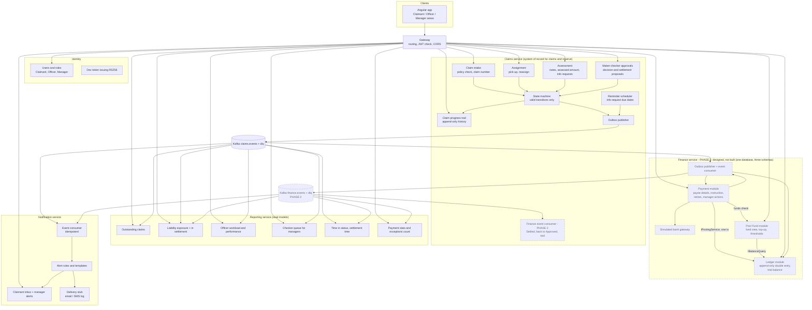
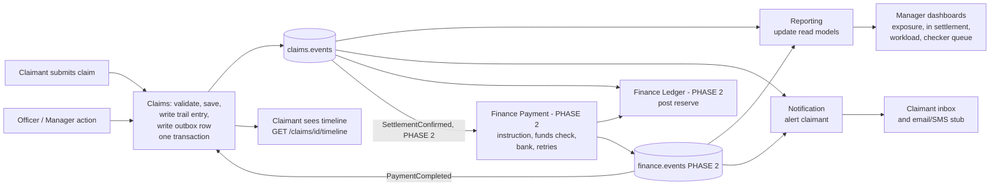
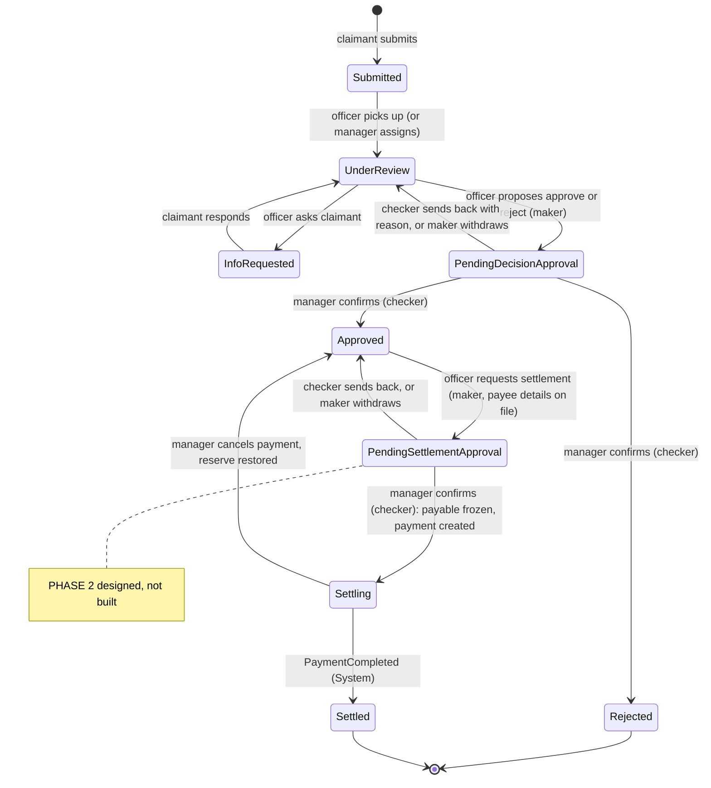
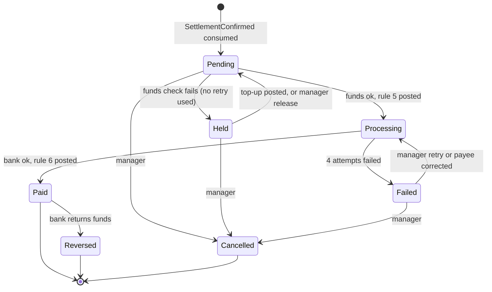
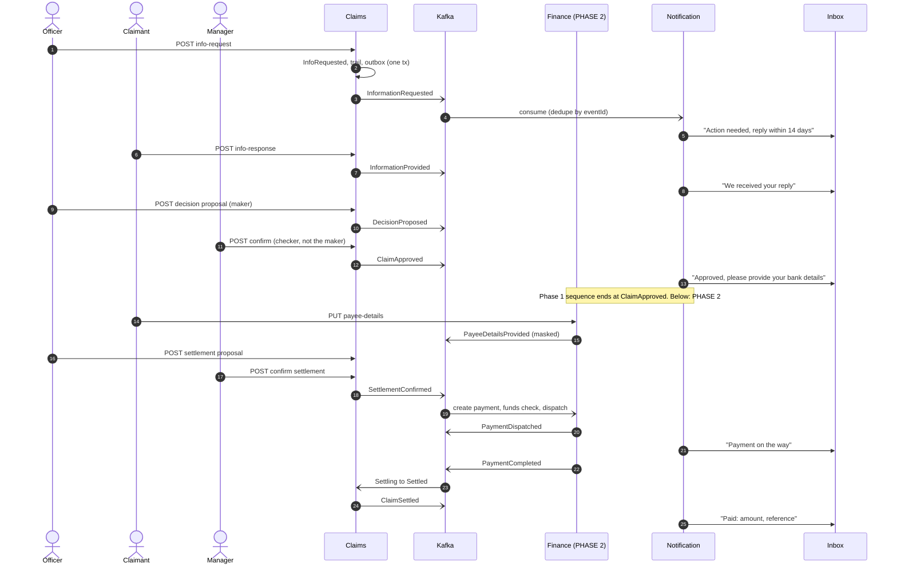

# Modules, Data Flow and Claimant Alerts

Status: **DRAFT** (owner: `architect`; domain input from `business-analyst`). Lifecycle, payment, ledger and pool fund reconciled with `docs/domain/business-rules.md` (BR-01 to BR-73). Decisions: `docs/adr/`. Mermaid renders in GitHub and the VS Code Markdown preview.

## 0. Phase boundary and cut line

Human decision: 5-hour cap kept. **Phase 1 (this build; what docker-compose runs today is in `docs/architecture/ARCHITECTURE.md` section 10):** Gateway, Identity, Claims (trail, maker-checker on the decision), Reporting, Notification; demo ends at **Approved**. **Phase 2 (designed, NOT built):** Finance service = Payment, General Ledger, Pool Fund; settlement maker-checker; `Settling`/`Settled`. In every diagram below, **dashed or "PHASE 2" labelled = designed, not built**; in tables see the Phase column. Finance is not in the Phase 1 docker-compose. **Cut line:** about 2:45-3:00 into the build, Claims + trail + decision maker-checker + Reporting + Notification work end to end; remaining time is hardening and tests, not Finance. Extension points left in Claims: see `docs/architecture/ARCHITECTURE.md` section 0.

## 1. Module map

Each service owns its database. Services talk only through REST (via the Gateway) or Kafka events. Inside Finance, modules own separate schemas and call each other only through in-process interfaces.

## 2. Data flow for one claim

Every action follows the same path: command (or consumed event) → state machine → trail entry + outbox row (one transaction) → Kafka → other services react.

## 3. Claim lifecycle with maker-checker and Settling

Rules (BR-31 to BR-39, BR-48, BR-50): the checker is always a Manager and never the maker (user-id comparison, so a dual-role user cannot self-approve), and can only confirm or send back, never edit. A pending proposal cannot be edited; the maker can withdraw it, and reassigning the maker auto-withdraws it. Reserve and exposure do not change until the checker confirms. A claim is Settled only when the bank-side payment succeeded. Failed or Held payments leave the claim in Settling.

### Payment states (Finance / Payment module) - PHASE 2: designed, not built

## 4. How each process alerts the claimant (and the manager)

| # | Process step | Trail entry | Claimant sees (Public) | Alert to claimant | Channel | Who is NOT told |
|---|---|---|---|---|---|---|
| 1 | Claim submitted | Claim received | "Claim received, number CLM-…" | **Yes**: confirmation with claim number | In-app + email stub | – |
| 2 | Officer picks up / manager assigns | Assigned | "Your claim is being reviewed" | **Yes** (first pick-up only) | In-app | Reassignment later: no alert, trail only |
| 3 | Officer requests information | Information requested | Question and due date (14 days) | **Yes, action needed** | In-app + email stub | – |
| 4 | Reminder before due date | Reminder sent | Reminder | **Yes** (reminder from scheduler) | In-app + email stub | – |
| 5 | Claimant responds | Information provided | "We received your reply" | **Yes**, acknowledgement | In-app | – |
| 6 | Officer proposes decision (maker) | Decision proposed (Internal) | "Decision under review" | **Optional**, no outcome revealed | In-app | Outcome, amount, reason, names hidden until confirmed |
| 7 | Manager sends decision back, or maker withdraws | Sent back / Withdrawn (Internal) | Nothing new ("Decision under review" stays) | **No** | – | Claimant never told of a send-back |
| 8 | Manager confirms approve | Approved | "Approved" with approved amount | **Yes**: approved, please provide bank details | In-app + email stub | – |
| 9 | Manager confirms reject | Rejected | "Rejected" with reason code and text | **Yes** | In-app + email stub | – |
| 10 | Officer requests settlement (maker) | Settlement requested (Internal) | "Settlement under review" | **Optional** | In-app | – |
| 11 | Payment first dispatched | Payment dispatched | "Payment on the way" | **Yes**, once per payment | In-app | Not repeated on retries |
| 12 | Payment completed, claim Settled | Settled | "Paid" with amount, currency, reference, date | **Yes** | In-app + email stub | – |
| 13 | Payment attempt failed, retries, Held, Failed, cancelled, reversed | Internal entries | Nothing (status stays Settling) | **No** | – | Claimant never sees failure, Held reason or fund data |
| 14 | Refused attempt (invalid transition, wrong user, maker=checker) | Refused attempt (Internal) | Nothing | **No** | – | Never shown to claimant |
| 15 | No reply by the due date | Closed or flagged (BR to be confirmed) | Notice | **Yes** | In-app + email stub | Pending BA confirmation of NO_RESPONSE handling |

Alert rules in one line: the claimant is alerted on **Public** trail entries that change what they must do or what they are owed. **Internal** entries never produce a claimant alert. The "Paid" alert is driven by `ClaimSettled` (Claims), so it is never sent before the claim is really Settled.

### Manager alerts (BR-65)
Payment failed after retries; payment Held for insufficient funds; payment reversed by bank; reconciliation break or DLQ message; ledger out of balance; fund below minimum threshold. One alert per event (idempotent), shown in the manager inbox, never sent to claimant or officer.

## 5. Alert sequence (information request, approval, payment)

## 6. Events and who consumes them

Columns Finance Payment and Finance Ledger, and every row after ClaimApproved that involves them, are **Phase 2: designed, not built**. Settlement and Payment* events, FundToppedUp and the finance alerts are Phase 2; all rows above SettlementRequested are Phase 1 (publisher and Reporting/Notification consumers).

Full contract table (payload, producer, topic) is in `docs/architecture/ARCHITECTURE.md` section 7. Summary by consumer:

| Event | Claims | Finance Payment | Finance Ledger | Reporting | Notification |
|---|---|---|---|---|---|
| ClaimSubmitted | – | – | rule 1 | counts, exposure | alert #1 |
| ClaimAssigned / ClaimReassigned | – | – | – | workload | alert #2 first only |
| InformationRequested / Provided / ReminderDue | – | – | – | status counts, time in status | #3, #4, #5 |
| ClaimAssessed | – | – | rule 2 | exposure | – |
| DecisionProposed / DecisionSentBack / ProposalWithdrawn | – | – | – | checker queue | none (optional #6) |
| ClaimApproved | – | stores claim_ref | – | exposure | #8 |
| ClaimRejected | – | – | rule 3 | exposure released | #9 |
| SettlementRequested / SettlementSentBack | – | – | – | checker queue | none (optional #10) |
| SettlementConfirmed | – | creates instruction | rule 4 | in-settlement | optional |
| ClaimSettled | – | – | – | exposure to paid, settlement time | #12 |
| SettlementCancelled | – | – | – | exposure up | none |
| PayeeDetailsProvided | payee flag, trail | – | – | – | – |
| PaymentRequested | trail | – | – | payment pipeline | – |
| PaymentHeld | trail | – | – | exceptions count | manager alert |
| PaymentDispatched | trail | – | (rule 5, in process) | – | #11 |
| PaymentAttemptFailed | trail | – | (rule 7, in process) | first-attempt rate | none |
| PaymentFailed | trail | – | – | exceptions queue | manager alert |
| PaymentCompleted | Settling to Settled | – | (rule 6, in process) | success rate | none (waits for ClaimSettled) |
| PaymentCancelled | Settling to Approved, reserve restored | – | (rule 9, in process) | exposure | none |
| PaymentReversed | trail only | – | (rule 8, in process) | – | manager alert |
| FundToppedUp | – | releases Held (in process) | (rule 10, in process) | optional | – |
| FundBelowMinimum / LedgerOutOfBalance / ReconciliationBreak | – | – | – | – | manager alert |
| RefusedAttempt | not published | | | | |

## 7. Modules and where they are built

Phase column: numbers 0-3 in older rows mean Phase 1 build steps (ARCHITECTURE section 11); "2" = Phase 2, not built. Settlement maker-checker is Phase 2; the maker-checker row below is Phase 1 for the **decision** only.

| Module | Service | Priority | Phase |
|---|---|---|---|
| Claim intake, state machine (9 states), progress trail, outbox | Claims | MUST | 1 |
| Assignment (pick-up, manager reassign) | Claims | MUST | 1 |
| Assessment (notes, assessed amount, info requests) | Claims | MUST | 1 |
| Maker-checker approvals (decision, settlement) | Claims | MUST | 1 |
| Finance event consumer (Settled, trail) | Claims | Phase 2, designed not built | 2 |
| Reminder scheduler for info requests | Claims | COULD, document | – |
| Read models: outstanding, exposure, workload | Reporting | MUST | 2 |
| Checker queue, time in status | Reporting | SHOULD | 2 |
| Payment stats and exceptions count | Reporting | Phase 2 | 2 |
| Alert rules, claimant inbox | Notification | MUST | 2 |
| Templates, stub delivery, manager alerts | Notification | SHOULD | 2/4 |
| Users, roles, dev JWT | Identity | MUST (thin) | 0 |
| Routing, JWT validation, CORS | Gateway | MUST (thin) | 0 |
| **Payment**: payee details, instruction, simulated bank, idempotency, 3 retries, Failed state | Finance | Phase 2, designed not built | 2 (F1) |
| **Ledger**: accounts, posting rules 1 to 7 and 10, idempotent, trial balance | Finance | Phase 2, designed not built | 2 (F1) |
| **Pool Fund**: seeded openings; balance = account 1000 | Finance | Phase 2, designed not built | 2 (F1) |
| Funds check and Held, fund view, top-up, auto-release, manager retry and queue | Finance | Phase 2, designed not built | 2 (F2) |
| Cancel and compensation, reversal, payee correction, reconciliation, threshold, coverage ratio | Finance | Phase 2, designed not built | 2 (F3) |

### Finance module contracts (in-process, no cross-schema SQL)

| Interface | Provided by | Used by | Notes |
|---|---|---|---|
| `IPostingService.Post(rule, sourceEventId, claimId, paymentId, amounts)` | Ledger | Payment, Fund, event consumer | Idempotent on `sourceEventId`; refuses unbalanced or mixed currency |
| `IBalanceQuery.Balance(account, currency, claimId?, asOf?)` | Ledger | Payment (funds check), Fund, REST views | Computed from lines |
| `IFundsGate.CheckAndReserve(currency, amount)` | Pool Fund | Payment | Holds the per-currency advisory lock for the duration of the transaction |
| `IBankGateway.Pay(idempotencyKey, payee, amount)` | simulated bank | Payment | Mock; scripted outcomes |

## 8. Open points
- Whether alerts #6 and #10 ("under review") are sent: BA/PO to confirm.
- Rule for a claimant who never replies (alert #15).
- Email/SMS are logged only; real delivery is documented as "not built".
- BR-42 allows the manager correction screen to show full bank details; the security design shows masked data on every read and makes correction write-only. BA/human to confirm.
- BR-44 "same transaction" is satisfied across services by outbox + unique-per-claim instruction (ARCHITECTURE section 8). BA to accept.
