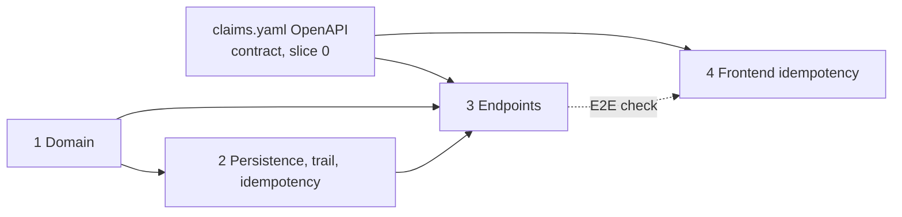

# Specs: index and order (architect note, 2026-10-28)

Each spec follows `SPEC-TEMPLATE.md`, is written by the implementing developer and gets an architect verdict (REVIEWED or CHANGES REQUESTED) in its Review record before coding starts. Priorities and stories stay with `product-owner` and `business-analyst`. This file only sets technical order and dependencies.

| Spec | Status |
|---|---|
| `identity-gateway/SPEC.md` | Reviewed (slice 0) |
| `claims-domain/SPEC.md` (spec 1) | REVIEWED (architect, 2026-10-28, re-review; binding text amendments listed in its Review record) |
| `claims-persistence/SPEC.md` (spec 2) | REVIEWED (architect, 2026-10-28) |
| `claims-api/SPEC.md` (spec 3) | REVIEWED (architect, 2026-10-28) |
| Frontend `docs/specs/claims-idempotency/SPEC.md` (spec 4) | REVIEWED (architect, 2026-10-28); step 6 blocked on `claims.yaml` |

## Why split Claims
Slice 1a (ARCHITECTURE section 11) is the largest and riskiest row: state machine, maker-checker, trail, outbox, idempotency and about 15 endpoints. One spec would be too big to review properly and too big to cut cleanly if time runs short. Four specs follow the layering in ARCHITECTURE section 9 ("Layering"). Each one can be reviewed and tested on its own and has a clear interface to the next.

## The four Claims specs, in order

| # | Spec (path) | Owner | Covers | Depends on | Tests that live here |
|---|---|---|---|---|---|
| 1 | `claims-domain/SPEC.md` | backend-developer | Claim aggregate, 9-state enum and Phase 1 transitions, Proposal (generic, decision only enabled), InformationRequest, money/reserve derivation, maker-not-checker on user id, reassign/release rules (ADR-009 decision 4), `Actor`, `Result` plus `DomainRefusal` with problem types (no exceptions; `DomainRefusalException` lives in Application, spec 2), trail entry model and claimant projections, event payload records in `Contracts` (ADR-010). No EF, no HTTP | ADR-005, ADR-009 (refusal shape), ADR-010, BR set from `docs/domain` | Domain unit tests: every transition and refusal, S11/S13/S14 at domain level |
| 2 | `claims-persistence/SPEC.md` | backend-developer (outbox write side reviewed with messaging-engineer) | `ClaimsDbContext`, migrations, `xmin` row version, `claim_history` append-only triggers and REVOKE, outbox table and write, `idempotency_keys`, `PostgresIdempotencyStore`, HTTP-free `IdempotentCommandExecutor` (advisory lock, savepoint, storability; ADR-009 amendment), **all command handlers** (incl. Reassign with `IOfficerDirectory`, Correction, settlement-stub refusal), `DomainRefusalException` (Application), `IRefusedAttemptRecorder`, UUIDv7 `IIdGenerator`, outbox `sequence` ordering (ADR-010), dev seeder through the command path | Spec 1 (aggregate, `DomainRefusal`, `PendingEvents`) | Testcontainers, no HTTP: I1 to I3, I5 to I8 and S33 at the executor level, S23 (claims part), atomicity (BR-84), races, sequence, trail-entry and outbox counts, seeder |
| 3 | `claims-api/SPEC.md` | backend-developer | Minimal API endpoint groups per ARCHITECTURE section 9 table, policies, `.WithIdempotency()` on every non-GET, the thin `IdempotencyFilter` adapter and `RequestBufferingMiddleware`, `ProblemResults` (the one problem-details mapping), DTOs, validators, queries, `UnmappedMemberHandling.Disallow`, settlement-stub routes (409 `phase-2-not-enabled`), `contracts/openapi/claims.yaml` kept in sync | Specs 1 and 2; OpenAPI contract (ADR-003) | API/security tests S1 to S16 (Claims variants), S32 (startup coverage test), S5, S6, and the HTTP-pipeline idempotency cases I4, S12, S34, S35 plus one replay smoke test per route family |
| 4 | Frontend repo `docs/specs/claims-idempotency/SPEC.md` | frontend-developer | Key generation per user action, keeping the exact serialised body bytes with the key (BR-81), retry on network error and on 409 `idempotency-request-in-progress` honouring `Retry-After`, handling `Idempotent-Replayed`, new key after a stored refusal or a 422 `idempotency-key-reused` | `contracts/openapi/claims.yaml` only (contract-first); end-to-end check needs spec 3 running | Frontend unit tests on the request wrapper; one E2E double-submit test |

## Order and parallelism

- 1 then 2 then 3 is strict: 2 needs the aggregate and the refusal type, and 3 wires both.
- 4 can be written and reviewed as soon as the OpenAPI contract is fixed, in parallel with 1 to 3. Only its end-to-end test waits for 3.
- Spec 2 may start its schema and migration part once spec 1's aggregate shape is reviewed, before the domain tests are all green.
- Cut order if time runs short (technical advice; `product-owner` decides): drop COULD endpoints in spec 3 (`reference-data`) before anything in specs 1 and 2. The trail, refused entries and idempotency are not cut (ADR-009 Consequences).
